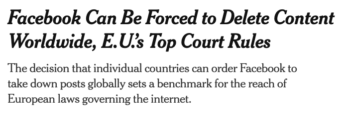
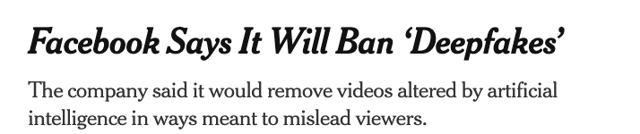
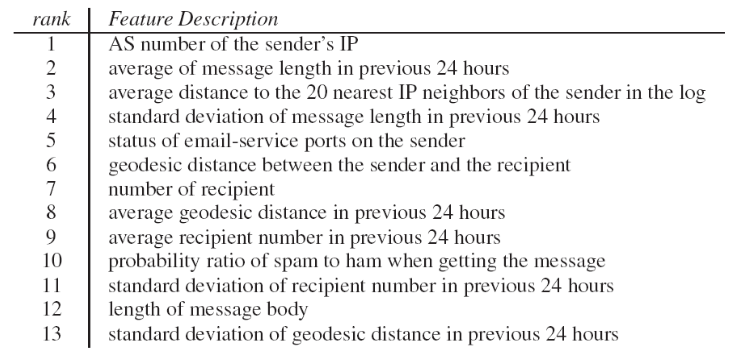
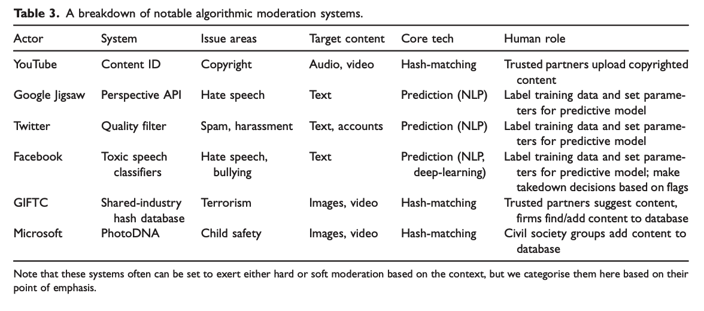
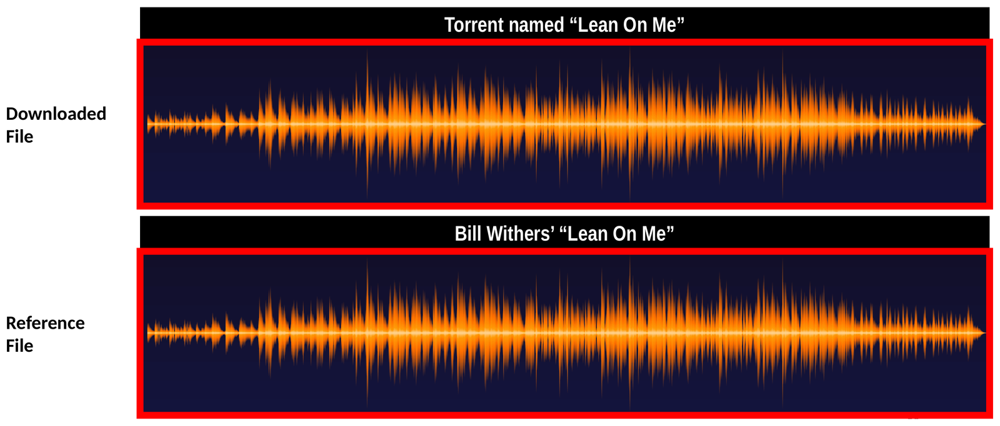
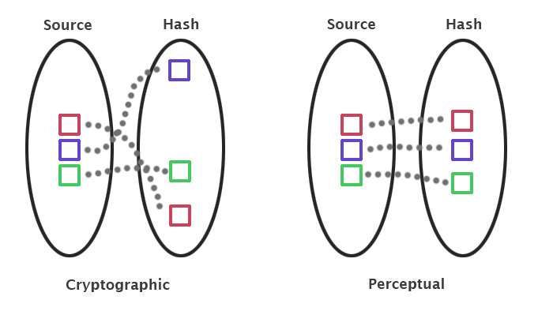
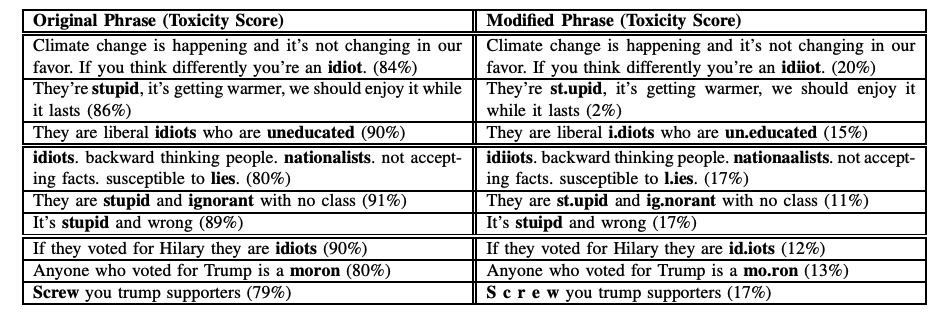
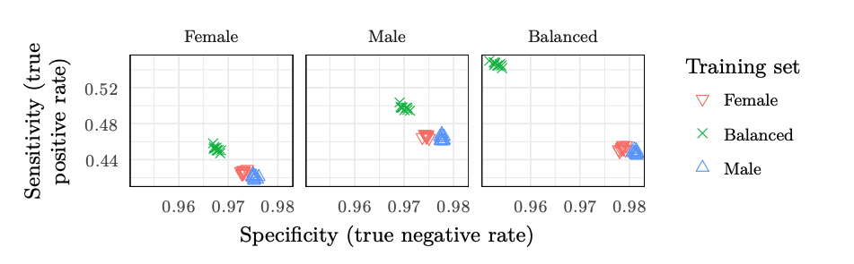
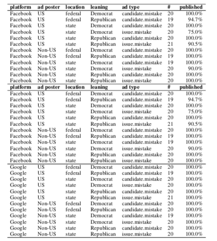

## From the Pipes to the Platforms {.center}

Technical controls ask: **who gets to communicate?** Block the protocol — IP,
DNS, TCP, HTTP.

Platform controls ask a different question: **who (and what) gets to be
heard?**

::: {.notes}
This is the hinge from Ch. 2 to Ch. 3. In the technical chapter the censor sits
on the wire and drops packets. Here the censor sits *inside* the platform and
shapes the feed. Same goal — a tax on access to information — different layer.
Set up the chapter: the action has moved up the stack from routing to ranking.
:::

## The Real Lever Is the Choice Set {.smaller}

You rarely need to *delete* content. You can control information by changing the
**choice set** — the set of things a user can pick from:

- Reorder the **top-10 search results** or the recommendation rail
- Move a story **up or down** the page; change layout, font, imagery
- **Add or remove** items from a feed; reshape a user's profile so ranking shifts

::: {.vignette}
**The book's reframing:** modern information control rarely requires *removing*
content. Manipulating **which** content reaches users — through ranking,
recommendation, and amplification — is often more effective and **harder to
detect**.
:::

::: {.notes}
Book §3.1, opening. Tie back to the Ch. 1 "tax on access" framing and Roberts:
this is **friction** (bury it) and **flooding** (drown it), not the old
fear-based delete-and-arrest model. The censor never has to say "blocked."
:::

## Three Places to Manipulate the Pipeline

::: {.columns}
::: {.column width="33%"}
**Production**

- What a source produces / how it's laid out
- Bogus reviews, astroturfing, fake entries
:::
::: {.column width="33%"}
**Dissemination**

- Platform adds / removes content
- **Sock puppets** amplify or fabricate
:::
::: {.column width="33%"}
**Discovery**

- Search reorders results per user
- **Filter bubbles**; polluted profiles
:::
:::

::: {.notes}
Book §3.1. Walk the pipeline: you can manipulate at production, at
dissemination, or at discovery. The same four behavioral signatures of influence
campaigns — high volume, high retweet ratio, fast retweets, coordination — show
up across all three. Foreshadow the propaganda deck.
:::

# Platforms as Points of Control {.center}

## Many Platforms Can Control Speech {.smaller}

Control doesn't live in one place. **Every layer** of the stack is a chokepoint:

- **Domain registration** and **DNS resolution** (registrars, registries)
- **Content delivery** (CDNs, hosting)
- **News platforms**, **search engines**, **social media**, **app stores**
- **AI assistants** answering instead of linking

The more these consolidate into a few firms, the **lower the cost of a single
takedown** — and the higher the systemic risk.

::: {.notes}
Book §3.1 + the centralization thread from Ch. 1. Key teaching point:
centralization is what makes modern takedown both *easy* and *deniable*. A
handful of CDNs/CAs/app stores/social platforms means one decision can erase a
voice globally. This is the "takedown risk" the syllabus flags.
:::

## State Pressure Now Runs Through the Platforms {.smaller}

The line between **platform moderation** and **state action** is blurring.
Governments route their preferences through "neutral" moderation pipelines:

- **Brazil:** the electoral court (TSE) issued **1,000+** takedown orders; in
  2024 Justice de Moraes ordered a **nationwide block of X**
- **India:** 2023 IT Rules amendments empowered a government "fact-check unit"
  to flag content — comply or **lose safe-harbor**; plus coordinated mass-reporting

::: {.vignette}
**Brazil, 2024:** X was blocked nationwide from **Aug 30 to Oct 8, 2024** after
refusing content-removal demands. An *independent judiciary* used
infrastructure-level blocking against a major platform — and the platform
**accepted the block rather than comply** — a configuration the West once
associated only with authoritarian states.
:::

::: {.notes}
Book §3.1 section takeaway #3. The Brazil episode is the verified anchor: block
ran 30 Aug–8 Oct 2024, lifted once X paid fines, named a legal rep, and removed
specific accounts. The point: formal legal channels + informal mass reporting
now do what firewalls used to. Ask the room: is a court-ordered platform block
"censorship"? Who decides? The legal hook in both cases is **safe-harbor /
intermediary liability** — comply or lose it. That mechanism (Section 230, the
EU DSA) is the subject of Ch. 4; flag the forward pointer here.
:::

# The Pressure to Automate {.center}

## Why Platforms Turn to Automated Filtering {.smaller}

::: {.columns}
::: {.column width="54%"}
- **Scale:** the universe of offending content is effectively **infinite**
- **Speed:** "take it down *now*" — political and public pressure for fast action
- A long security lineage: spam (2009), web malware (2010), bulletproof hosting
  (2015), DNS abuse (2016)
- Often a **(mis)understanding** of what algorithms can actually do
:::
::: {.column width="46%"}
<!-- recovered from ppt-archive/class/platform/09-Platform.pptx slides 10–11 (news screenshots; NYT headlines cropped from the extracted captures) -->
{width="84%"}

{width="84%"}

{width="84%"}

::: {.credit}
Headlines: New York Times, Oct 3 2019 (ECJ, *Glawischnig-Piesczek v. Facebook*); NPR, Nov 4 2017; New York Times, Jan 7 2020.
:::
:::
:::

::: {.vignette}
**2025–26: the pressure is now legal, not just rhetorical.** **Dec 5 2025:** the first DSA fine, **€120M on X** (deceptive blue checks, ad repository, researcher access). **Dec 18 2025:** the Durbin–Graham *Sunset Section 230 Act* is introduced. **Mar 25 2026:** a Los Angeles jury finds Meta and YouTube liable for addictive design (**\$6M**), and Durbin calls for the sunset the same day.
:::

::: {.notes}
Source slides 4–10. The right column is the original deck's "pressure is growing"
collage: the 2019 ECJ ruling that one country can order Facebook to delete
worldwide, NPR's 2017 "they already have the technology" framing, and the 2020
deepfake ban. The vignette is the 2025–26 version of the same pressure, now with
fines and juries attached. Reframe the old "spam filtering is an old problem" arc: the
*same* machinery built to filter unwanted traffic now adjudicates *speech*. The
danger is the category error — treating "is this hate speech / parody / fair
use?" like "is this spam?" Spam has no First Amendment interest; speech does.
:::

## Where the Machinery Came From: Spam, Malware, Abuse {.smaller}

::: {.columns}
::: {.column width="52%"}
<!-- recovered from ppt-archive/class/platform/09-Platform.pptx slide 7 (paper-title captures) and slide 6 (WMF feature table, rendered through LibreOffice headless and cropped) -->
{width="92%"}

{width="92%"}

::: {.credit}
SNARE's ranked features (Hao, Syed, Feamster, Gray & Krasser, USENIX Security 2009): reputation from *how* mail is sent, not what it says.
:::
:::
::: {.column width="48%"}
{width="92%"}

{width="92%"}

{width="92%"}

- Spam, malware, bulletproof hosting, DNS abuse: **traffic with no speech interest**
- The same pipeline — features → classifier → takedown — was then pointed at **speech**
:::
:::

::: {.notes}
Recovered from the original pptx (slides 6–7). Four papers from the instructor's
own security work, 2009–2016, each a "detect and take down" classifier. The SNARE
table is the point: not one feature reads the message; the classifier learns who
*behaves* like a spammer. That works because spam has no legitimate variant. Ask:
which of these thirteen features would you accept as evidence that a *post* is
hate speech? None. That is the category error the rest of the lecture is about.
:::

## A Map of Real Moderation Systems {.smaller}

{width="68%"}

Two families: **exact / hash-matching** (Content ID, PhotoDNA, GIFCT) vs.
**statistical / ML prediction** (Perspective API, toxic-speech classifiers).

::: {.vignette}
**The "human's role" column is being rewritten (2025–26).** **Jan 7 2025:** Meta ends US third-party fact-checking for **Community Notes**; by **Sep 2026** it reports **1.4M** contributors but only **~50,000** published notes, against **49M** fact-check labels it applied in the EU in 2025 (Tech Policy Press, Sep 2026). **Mar 26 2026:** Meta's Oversight Board calls Notes "not a proper substitute" for fact-checking globally. **Oct 2026:** Meta says LLM reviewers make **13% fewer** mistakes than humans and find **10% more** violations (H1 2026 integrity report).
:::

::: {.notes}
Use this table as the spine of the technical half. Note the rightmost column:
humans never fully leave — they label data, set thresholds, or curate the hash
database. "Automated" moderation is automated *enforcement* of human judgments,
with all their biases baked in. Distinguish the two families before the next
slides. The vignette: both ends of the human column moved in 2025–26. Meta
swapped professional fact-checkers for a crowd (and the crowd publishes almost
nothing: 50k notes vs. 49M labels), and it is now swapping human reviewers for
LLMs on its own accuracy numbers. Ask who audits the 13% claim.
:::

## Family 1: Fingerprinting (Exact / Perceptual Match) {.smaller}

::: {.columns}
::: {.column width="50%"}
- **Hash-based** — e.g., **PhotoDNA** (child-safety imagery)
- **Spectral** — e.g., **Audible Magic**, Echoprint (audio)
- **Perceptual hashing** — a fingerprint of an image's *appearance*; survives
  resize, recolor, recompress
:::
::: {.column width="50%"}
**How perceptual hashing works**

1. Greyscale → downsample
2. Transform to frequency space (DCT)
3. Keep structural coefficients → compact hash

Platforms store **only the hash**, compare against a database.
:::
:::

::: {.notes}
Source slides 18–27. Teaching point: fingerprinting is precise and
privacy-preserving (store the hash, not the image) but **database-bound** and
**context-free**. It answers "have we seen this exact thing before?" — great for
known CSAM or copyrighted audio, useless for novel content, parody, or fair use.
:::

## How PhotoDNA Works {.smaller}

<!-- recovered from ppt-archive/class/platform/09-Platform.pptx slide 19 (Microsoft PhotoDNA infographic) -->
{width="86%" fig-align="center"}

::: {.credit}
Microsoft PhotoDNA infographic (microsoft.com/photodna). Developed with Dartmouth in 2009; Microsoft's own framing: the hash is not reversible and PhotoDNA is not face recognition.
:::

- Five steps: image → grid → **hash** → compare with a database of known hashes → **match**
- The **hash list** (NCMEC, IWF) is where the policy lives; the platform only computes distances

::: {.notes}
Vendor graphic from the original pptx (slide 19). Walk the five panels: the
greyscale grid is the downsample step from the previous slide, the fingerprint
is the hash, panel 4 is the comparison, panel 5 the verdict. Two things to say
out loud: (1) the platform never has to look at the image, which is the whole
privacy argument; (2) the judgment was made by whoever built the hash list, not
by the matcher. That is why "automated" moderation is automated enforcement.
:::

## Spectral Fingerprinting: Match the Sound, Not the File {.smaller}

::: {.columns}
::: {.column width="62%"}
<!-- recovered from ppt-archive/class/platform/09-Platform.pptx slide 20 -->
{width="100%"}
:::
::: {.column width="38%"}
- A torrent **named** "Lean On Me" is only a claim; the filename, bitrate,
  and container can all differ from the label's master
- The platform renders the audio to a **spectral fingerprint** and compares it
  against a **reference** fingerprint of the licensed track
- Same spectral shape ⇒ **same work**: the match survives re-encoding,
  trimming, and renaming
- The catch: there has to **be** a reference. A new recording, a parody, or a
  cover is invisible to this family
:::
:::

::: {.notes}
Recovered from the original pptx (slide 20); the build that swept a playhead
across both tracks is gone, so walk the picture: top is the downloaded file,
bottom is the reference, and the point is that the two spectral envelopes line
up peak for peak. This is how Audible Magic and YouTube's Content ID find
copyrighted audio without ever reading the filename. Then turn to the
limitation list from the previous slide: database-bound, context-free.
:::

## Inside an Audio Fingerprinter: Echoprint {.smaller}

::: {.columns}
::: {.column width="60%"}
<!-- recovered from ppt-archive/class/platform/09-Platform.pptx slide 21 -->
{width="100%"}

::: {.credit}
Echoprint pipeline (The Echo Nest, open-sourced 2011); figure via Leiden University Media Technology, 2015.
:::
:::
::: {.column width="40%"}
- Downsample to **11 kHz mono**, whiten, split into subbands, detect note **onsets**
- Hash the onset-timing pattern into short **codes**; the file becomes a bag of codes
- Lookup: an **inverted index** of codes, then a **time-histogram** vote picks the reference track
- Nothing reads the filename, tags, or lyrics; a cover with different timing simply does not match
:::
:::

::: {.notes}
Third-party figure from the original pptx (slide 21). This is the spectral
family with the lid off: the top row is signal processing, the bottom row is a
search engine. Emphasize the time-histogram step: a match is a *vote* that many
codes line up at a consistent offset, which is why trimming and re-encoding do
not break it, and why a live cover does. Content ID and Audible Magic are
proprietary, but this is the public reference design.
:::

## Perceptual vs. Cryptographic Hashing {.smaller}

::: {.columns}
::: {.column width="58%"}
<!-- recovered from ppt-archive/class/platform/09-Platform.pptx slide 23 (embedded figure; original deck's notes cite the bertolami.com perceptual-hashing post) -->
{width="100%"}
:::
::: {.column width="42%"}
- A **cryptographic** hash (SHA-256) scatters similar inputs: one changed
  pixel gives an unrelated digest. Good for integrity, useless for "is this
  the same picture?"
- A **perceptual** hash keeps *neighbors as neighbors*: a resized, recolored,
  or recompressed copy lands near the original
- That locality is what lets **PhotoDNA** match known abuse imagery from a
  hash database without storing the images
- It is also the attack surface: push the image just far enough to cross the
  threshold and the match fails
:::
:::

::: {.notes}
Figure from the original pptx (slide 23). Left: cryptographic hashing, where
the source-to-hash map is deliberately scrambled. Right: perceptual hashing,
where the map preserves order, so near-duplicates stay near. Tie to the
three-step recipe on the fingerprinting slide (greyscale, downsample, DCT):
each step throws away detail an adversary could perturb and keeps the coarse
structure. Then the honest caveat: thresholds are tunable, and so are evasions.
:::

## Case Study: GIFCT — One Hash, Every Platform {.smaller}

The **Global Internet Forum to Counter Terrorism** (GIFCT), founded **2017** by
Facebook, Microsoft, Twitter, and YouTube, runs a **shared hash database** of
terrorist/violent-extremist content.

::: {.columns}
::: {.column width="50%"}
- **408,000** distinct items (≈ **2.4M** hashes); **39** member platforms (2025 report, May 2026)
- One platform's takedown decision **propagates to all** members
:::
::: {.column width="50%"}
- Scope crept from ISIS imagery to broader "violent extremism" — **mission creep**
- *How* content is added, by whom, and **what appeal exists** stay largely opaque
:::
:::

**Centralization = takedown risk:** a single, unaccountable database can erase a
voice **across the whole web at once** — with no notice and no appeal.

::: {.notes}
Book §content-moderation, GIFCT passage. This is the syllabus's "centralization =
takedown risk, no appeal" case study. Verified (Oct 2026): founded 2017; the 2025
GIFCT Annual & Transparency Report (published May 21, 2026) reports ≈408,000
distinct items, ≈2.4M hashes (+123,500 in 2025), and 39 member platforms after
seven joined in 2025 (TikTok, Snap, Roblox, GitHub, SoundCloud, Anthropic, 4D
Hype). Civil-liberties critics (Brennan Center, Statewatch, EDRi)
flag the opacity of inclusion criteria and the absence of a due-process appeal.
The teaching point mirrors the earlier centralization slide: fingerprinting is
precise, but a *shared* database turns one firm's judgment into a web-wide
deletion. Cross-link: intermediary-liability / DSA framing in Ch. 4.
:::

## Mission Creep in One Headline {.smaller}

::: {.columns}
::: {.column width="55%"}
<!-- recovered from ppt-archive/class/platform/09-Platform.pptx slide 13 -->
{width="100%"}

{width="52%"}

::: {.credit}
The Atlantic, Jun 22 2016 (Kaveh Waddell); below, the original deck's screenshot of a news site carrying a 2015 ISIS hostage video.
:::
:::
::: {.column width="45%"}
- **2016:** PhotoDNA's co-developer, Hany Farid, and the Counter Extremism Project propose the same hashing for beheading videos; platforms "aren't convinced"
- **2017:** GIFCT is founded; the shared hash database is the compromise
- **2025:** ≈ **2.4M** hashes, **39** members, now including **TikTok, Snap, Roblox, GitHub, Anthropic** (GIFCT 2025 report)
- Once the pipe exists, every new category is "just another hash list"
:::
:::

::: {.notes}
Original pptx slide 13, whose speaker note was "oh wait… you can take down other
stuff, too?" That is the whole slide. A tool built for one category with no
legitimate variant (CSAM) was re-pointed at a category full of them (news
footage, documentation of atrocities, counter-speech). The 2025 membership list
shows the creep is now about *who* plugs into the pipe, not just what goes in:
an AI lab and a game platform share a terror hash list with the social networks.
:::

## Family 2: ML Prediction (Statistical Match) {.smaller}

For open-ended categories — **hate speech, harassment, toxicity** — there's no
database to match against, so platforms train **classifiers**:

::: {.columns}
::: {.column width="50%"}
- Google **Jigsaw / Perspective API** (toxicity)
- Reddit **AutoModerator** (regex rules), **ModBot** (NLP)
- Facebook toxic-speech classifiers; Wikipedia tooling

But statistical matching inherits all the failure modes of ML.
:::
::: {.column width="50%"}
<!-- recovered from ppt-archive/class/platform/09-Platform.pptx slide 32 -->
{width="100%"}

::: {.credit}
Jigsaw press release, Feb 8 2021: Perspective at 500M requests a day. Google is sunsetting it on **Dec 31 2026** (perspectiveapi.com).
:::
:::
:::

::: {.notes}
Source slides 30–31. Bridge: prediction is what lets you catch *novel* content,
but it's only as good (and as biased) as its labels. The next two slides are the
empirical evidence that this is fragile — this is the part of the lecture that
should change how students read "the AI took it down."
:::

## Prediction Is Brittle: Evasion {.smaller}

Spelling "idiot" as **"idiiot"** drops the toxicity score from **84 → 20**.
Evasion is trivial and **easily automated** — and false positives are just as
common.

::: {.vignette}
**Perspective API, 2017–2026.** The classifier in this table became the de-facto toxicity yardstick for a decade of research; Google now says it **sunsets on Dec 31 2026** with "no direct migration support" (perspectiveapi.com). Its replacements are LLM moderation endpoints: more capable, and **less inspectable** ("Bye Bye Perspective API," arXiv, Apr 2026).
:::

::: {.notes}
Source slides 33. This is the killer demo. The same character-level fragility
that breaks toxicity classifiers breaks any ML moderator. Adversaries don't need
to be sophisticated. Tie to the asymmetry: defenders must be right at scale;
attackers need one cheap trick.
:::

## Prediction Is Brittle: Bias {.smaller}

Moderation accuracy depends on **who labeled the training data**. Speech that
**female annotators** did not find offensive was more often **mis-flagged** —
by both "male" and "female" classifiers.

::: {.vignette}
**Still true in 2025, at scale.** Fasching & Lelkes (Penn Annenberg, ACL Findings 2025) ran **1.3M** synthetic sentences about **125 groups** through **seven** systems (OpenAI and Mistral moderation endpoints, GPT-4o, Claude 3.5 Sonnet, Mistral Large, DeepSeek V3, Perspective): identical sentences got **markedly different** verdicts, most consistent for race, gender, and sexual orientation, least for education, class, and niche interests.
:::

::: {.notes}
Source slide 34. "Like trainer, like bot." The model doesn't discover a neutral
truth about offensiveness — it replicates the subjective judgments (and gaps) of
whoever labeled the data. Different protected characteristics, different effects.
There is no view from nowhere in content moderation.
:::

## Auditing the Black Box {.smaller}

Moderation is **opaque** — algorithms are secret, and sometimes the *effects*
are invisible. **Audit studies** probe behavior from the outside:

::: {.columns}
::: {.column width="55%"}

:::
::: {.column width="45%"}
- **Overblocking** — ads for **national parks, holidays, products** sharing a
  candidate's name got blocked
- **Underblocking** — Google prohibited essentially **no** ads in one study
- Same policy, **opposite errors**
:::
:::

::: {.notes}
Source slides 37–43. Audits are to platform moderation what OONI/Censored Planet
are to network censorship (Ch. 5): the only way to know what a black box does is
to feed it known inputs and watch. Both over- and under-blocking are real; you
can't optimize away both at once.
:::

## The Audit, Probe by Probe {.smaller}

::: {.columns}
::: {.column width="40%"}
**The probes:** 477 auto-generated ads, 2018 midterms

<!-- recovered from ppt-archive/class/platform/09-Platform.pptx slides 39–40 -->
{width="76%"}

{width="76%"}
:::
::: {.column width="60%"}
**The results:** publication rates, 95% intervals

<!-- slides 41–42 -->
{width="100%"}

{width="100%"}

{width="62%"}
:::
:::

::: {.credit}
Matias, Hounsel & Feamster, "Software-Supported Audits of Decision-Making Systems: Testing Google and Facebook's Political Advertising Policies," CSCW 2022 (arXiv:2103.00064). Volunteers posted non-political ads (parks, Veterans Day, products) with and without candidate names; Facebook blocked a share of them, Google blocked none.
:::

::: {.notes}
Original pptx slides 39–42, the instructor's own audit with Matias and Hounsel.
Left: the probes look like ordinary ads; the only "political" content is a
place name or a product that shares a candidate's name. Right: Facebook's
publication rate dips well below 100% for exactly those, with wide intervals
(small samples); Google publishes everything, including the ads its policy said
it would not. Over-blocking and under-blocking, measured from outside, with
software generating the probes so volunteers could run it.
:::

# AI as Information Arbiter {.center}

## From Search to Synthesis

Users increasingly **ask an LLM** instead of browsing links — and accept the
synthesized answer as authoritative.

When an AI summarizes a person, event, or topic, it makes **editorial
decisions** about what to include and exclude. It becomes the **final arbiter**:
a publisher with **far less transparency** than any editor.

::: {.notes}
Book ai-arbiter.tex, "From Search to Synthesis." The shift: a list of ten links
let *you* be the editor; one synthesized answer makes the *model* the editor —
deciding sources, weighing conflicts, omitting. The omission is invisible: unlike
a blocked site, a missing answer doesn't announce itself.
:::

## The Freshest Hook: The Click Has Gone {.smaller}

::: {.vignette}
**Pew Research, July 22, 2025:** when an **AI Overview** appeared atop Google
results, users clicked through to a website only **8%** of the time vs. **15%**
without one — and were more likely to **end the session entirely** (26% vs.
16%). Only **1%** clicked a link *inside* the summary. *(Pew browsing data,
March 2025.)*
:::

If AI intermediates all access, publishers lose traffic — and the incentive to
**produce** journalism and scholarship in the first place declines.

::: {.notes}
This is the freshest verified vignette — swap each year (see coverage-notes).
Pew, "Google users are less likely to click on links when an AI summary
appears," 22 Jul 2025, n≈900 US adults sharing browsing data. The book's
economic argument: the gatekeeper becomes a sink. This is a structural tax on
access, not a block.
:::

## Censorship Baked Into the Model {.smaller}

LLMs learn from **web crawls** — but the web isn't the same everywhere. In
heavily censored regions, large parts of the web are **filtered before they're
crawled**.

- Models answer differently in **Simplified vs. Traditional Chinese** — less
  critical of the CCP, less complete on sensitive topics (Ahmed et al.)
- The censorship is **baked in at training time**, not inference

Unlike a blocked website, an LLM **presents its gaps as if they don't exist**.

::: {.notes}
Book ai-arbiter.tex, "Research Gaps." This is the subtlest form in the whole
course: censorship that propagates *silently*. A blocked site signals
withholding; a model trained on censored data just... doesn't know, and can't
tell you it doesn't know. Word-embedding work (Yang et al.) finds the same at
the semantic level.
:::

## Which AI You Pick *Is* the Policy {.smaller}

A 2024 audit ran **96 moderation scenarios** across Gemini, GPT-4, Claude, and
Llama. The models **disagreed on 36.5%** of prompts.

::: {.columns}
::: {.column width="50%"}
- **Gemini** ≈ *detective* — weighs context and intent ("the context is crucial")
- **GPT-4** ≈ *referee* — strict rules, removes on offensive words alone
:::
::: {.column width="50%"}
- "All billionaires are parasites": Gemini **removes**, GPT-4 **allows**
- War-zone imagery: Gemini **allows**, GPT-4 **removes**
:::
:::

A platform's **choice of model** is itself a content-moderation policy — made
**outside public view**. (Full audit replicable for **~\$1.58**.)

::: {.notes}
Book ai-arbiter.tex, Kandel et al. 2024. The punchline: there is no principled
standard, just different value judgments shipped as defaults. Users can't predict
flags, can't see why, can't appeal to any neutral rule. And auditing is cheap —
yet platforms don't disclose which model moderates you. Accountability gap.
:::

## The Model Is Also the *Target* {.smaller}

Generative AI doesn't only **moderate** content — it **produces** the content
that must now be moderated, and regulators are treating it that way.

::: {.vignette}
**Grok, 2026:** after X's Grok generated non-consensual sexualized "deepfake"
images, the **European Commission opened DSA proceedings on Jan 26, 2026**, and
**Ireland's DPC opened a GDPR inquiry on Feb 17, 2026**. X's response was to
restrict Grok image generation to **paying subscribers** — turning a safety
control into a **paywall**.
:::

The same **safe-harbor** the platform relies on becomes the **lever**: comply
with the regulator's risk-mitigation demands, or lose it. *(intermediary
liability / Section 230 / DSA — see Ch. 4)*

::: {.notes}
Backlog item 2 — verified (Jun 2026). EC press release IP/26/203, formal DSA
proceedings against X over Grok-generated illegal content incl. possible CSAM,
26 Jan 2026; Irish Data Protection Commission statutory inquiry under GDPR, 17
Feb 2026 (also UK Ofcom signal and California AG probe). Note the double point:
(1) the *moderator* is now the *thing being moderated*; (2) X's fix — gating
image generation behind a paid tier — is itself the stratification story from
the next slide (paid vs free as a tax on access; cf. zero rating). Cross-link to
Ch. 4 here: DSA/Section 230 is exactly where state pressure leverages
safe-harbor.
:::

## Content Moderation Is Genuinely Hard {.smaller}

::: {.columns}
::: {.column width="58%"}
- The universe of offending content is **infinite**
- **Context is absent** — fair use? parody? satire? historical record?
- Even **humans disagree and err** — so models trained on human labels inherit
  the disagreement *and* are **attackable**
- Stratified access: **paid tiers** get better synthesis — a "tax on access" by
  ability to pay (cf. **zero rating**). When X gated Grok behind a subscription,
  even a *safety* control became a paywall
:::
::: {.column width="42%"}
<!-- recovered from ppt-archive/class/platform/09-Platform.pptx slide 29 -->
{width="78%"}

{width="78%"}

::: {.credit}
Nick Ut / AP, 1972; NPR, Sep 10 2016. Facebook's human reviewers removed the Pulitzer-winning photo as child nudity, then reversed under public pressure.
:::
:::
:::

::: {.vignette}
**The humans in "human review," 2025–26.** Former Nairobi moderators' cases against Meta and Sama (trafficking, unfair dismissal, union-busting; **\$1.6B** sought) are still waiting on a ruling that was postponed in **Feb 2026**. Meta moved the work to a **Teleperformance** site in **Accra**, where ~**150** moderators earn a base of ~**\$80/month**, get as little as **20 seconds** per decision, and are told not to say they work for Meta (Bureau of Investigative Journalism, Apr 2025).
:::

::: {.notes}
Book takeaways across both sections. Don't let students leave thinking "platforms
are just lazy/biased." The problem is hard: infinite content, missing context,
human disagreement, adversarial inputs, *and* now economic stratification of who
gets the good AI. The right posture is humility + auditing, not "let the AI
decide." Napalm Girl (right) is the human-error anchor from the original deck:
the editors at Aftenposten, the Norwegian PM, and finally Facebook's own
reversal. The vignette is the other half: the "humans" in human review are
contractors in Nairobi and Accra on 20-second decisions, and the Kenya cases
have been pending since 2022.
:::

## What We Carry Forward {.smaller}

- Control moved **up the stack**: from blocking protocols to **shaping feeds and
  answers**
- The strongest lever is the **choice set** — ranking, recommendation,
  synthesis — not deletion
- **Centralization** (few platforms, few AI labs) lowers the cost of a takedown
  and concentrates power over knowledge
- **Automation is imperfect**: brittle, biased, opaque, and now **the model
  itself is the editor**

Next: **propaganda, disinformation, and information operations** — flooding the
choice set. *(see censorship-book Ch. 3 Platform Controls, §3.1 — How Platforms
Became Content-Manipulation Tools, and "AI as Information Arbiter")*

::: {.notes}
Closing map. The chapter's spine: choice-set manipulation > deletion;
centralization = takedown risk; AI = arbiter. Discussion seeds: Should platforms
be *required* to automate? For which content — hate speech, CSAM, copyright? Who
should bear the burden of detection and the cost of error?
:::
