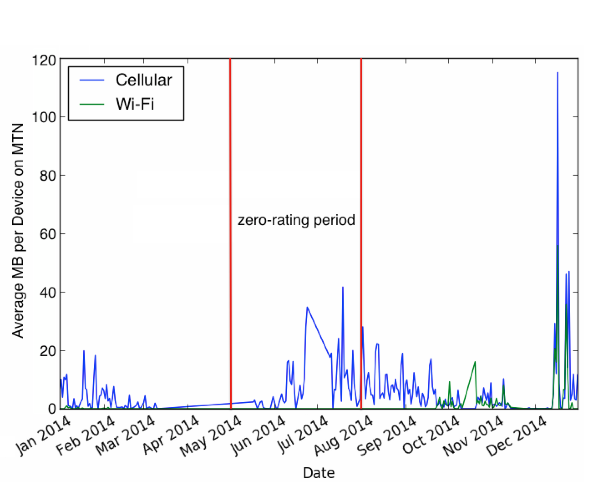
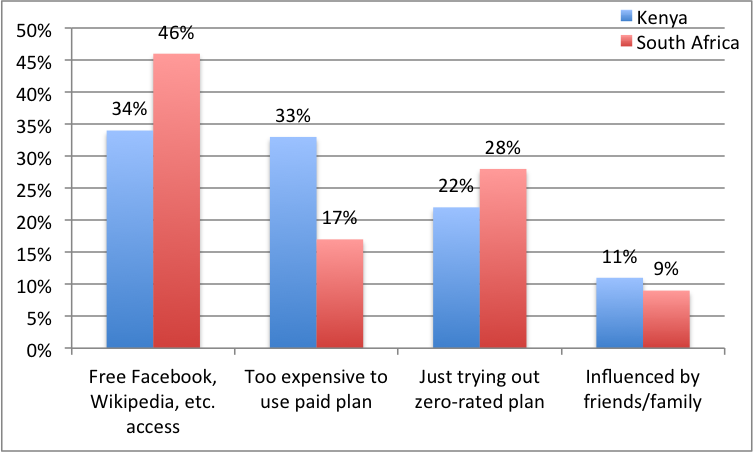
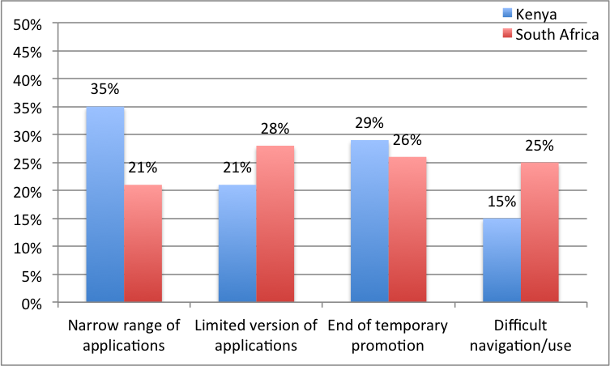
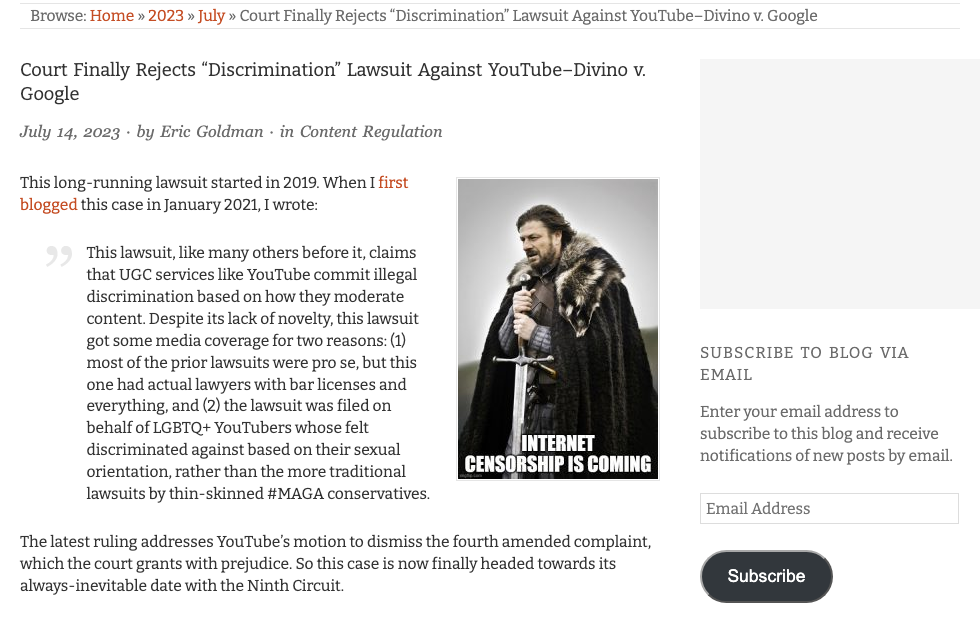
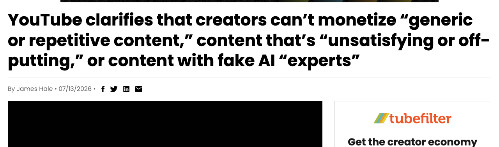
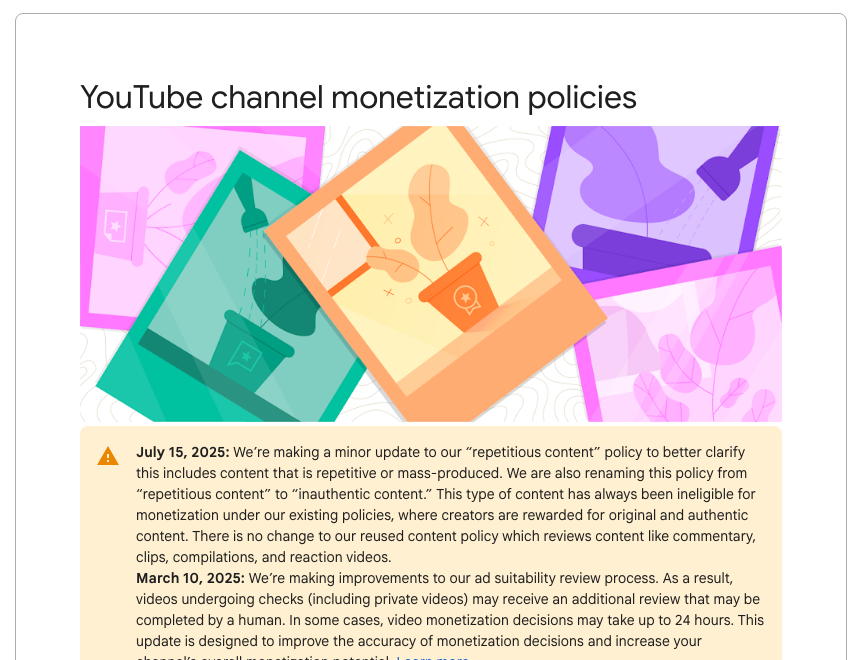
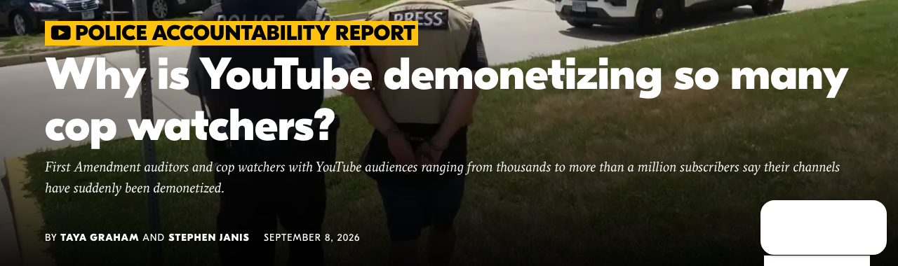
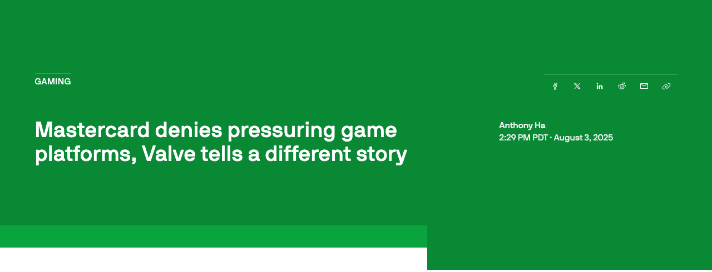

# Control by Pricing, Not Blocking {.center}

The economic-mechanics companion to net neutrality: how **money** shapes
**access to information**.

::: {.notes}
This deck is the economics half of the legal/economic chapter. The net-neutrality
deck covered the policy fight; here we focus on the mechanisms — fast lanes,
sponsored data, zero rating — and on the central claim from the book: pricing is a
*soft* form of information control. See censorship-book Ch. 4, §4.3–4.4.
:::

## Pricing as a Tax on Information

The course thesis: information control is **any tax on access to information**.

- A **block** forbids the content outright — the crudest tax
- **Paid prioritization** and **zero rating** are subtler: they leave content
  *reachable* but make some of it **cheaper, faster, or easier** than the rest
- Roberts's frame: this is **friction** — not a wall, a **toll** most users
  won't pay to go around

::: {.notes}
Anchor everything in the "tax on access" framing from Ch. 1. The book is explicit:
if we view economics/pricing as a way of introducing Roberts's "friction," then
paid prioritization restricts who receives what information *based solely on their
ability or willingness to pay.* No one is blocked — the price does the steering.
:::

## Two Mechanisms, One Effect {.smaller}

::: {.columns}
::: {.column width="50%"}
**Paid prioritization**

- A content source **pays the ISP** for faster/better delivery — a "fast lane"
- Or the ISP **throttles** what hasn't paid — a "slow lane" by another name
- Discrimination happens **inside the network**
:::
::: {.column width="50%"}
**Zero rating**

- Traffic to certain sites is **not metered** against the user's data cap
- The user pays **nothing** for "blessed" services, normal rates for everything else
- Discrimination happens **on the bill**
:::
:::

Both pick **winners among applications** — exactly what net neutrality forbids.

::: {.notes}
Keep the distinction crisp: prioritization changes *speed*, zero rating changes
*price*. Both produce the same downstream effect — they tilt the playing field
toward some content and away from the rest. The book frames net neutrality as
fundamentally "whether ISPs can discriminate among content sources" via blocking,
throttling, or paid prioritization.
:::

## A Quick Detour: The Internet's Business Model {.smaller}

The Internet is **tens of thousands of independent networks (ASes)** that interconnect.
Two ways money flows:

- **Customer–provider**: one AS *pays* another for reachability
- **Settlement-free peering**: bartering — two ASes swap traffic, no money, mutual benefit

Paid prioritization and **peering disputes** both live here — and they are easy to confuse.

::: {.notes}
You need this to read the Netflix/Comcast story correctly. Net-neutrality rules
govern the *access* ISP's treatment of traffic; peering disputes are economic
negotiations *between* networks. Same plumbing, different question. See
Fig. "Internet business model" in the book.
:::

## Was Comcast "Blocking" Netflix? {.smaller}

2014: streaming-video congestion spikes; popular story said ISPs were **blocking** content.

- The real story: a **classic peering dispute**, more economics than censorship
- **Netflix**: "I already paid transit (Cogent) to carry my bits to your eyeballs"
- **Comcast**: "You can congest any link you choose — balance your own traffic"
- Resolved **in the market**: Netflix paid Comcast to add interconnect capacity

::: {.notes}
The teaching point: not every slowdown is censorship. M-Lab tests *looked* like
ISP throttling but the congestion was actually in a transit network (Cogent), and
the end-to-end test crossed multiple ASes. Distinguishing blocking/throttling/paid
prioritization from an economic peering dispute is the analytical skill here.
:::

## The Rules: Net Neutrality's "Bright Lines"

The 2015 FCC **Open Internet Order** reclassified ISPs as **Title II** common carriers:

- **No blocking** lawful traffic
- **No throttling** lawful traffic
- **No paid prioritization** — no selling fast lanes

With a carve-out for **"reasonable network management"** (security, congestion).

::: {.notes}
Note what the rule does *not* do: it never banned all prioritization — an ISP can
always prioritize all video over all bulk transfer. The line is about
*application-specific* discrimination: FaceTime over Skype, Netflix over a rival.
Repealed 2017, reinstated 2024 — a political pendulum.
:::

## The Regulatory Pendulum {.smaller}

Net neutrality regulation **comes and goes** with the political climate:

| Year | What happened |
|---|---|
| **2015** | Open Internet Order — Title II, bright-line rules |
| **2017** | Repealed (Restoring Internet Freedom Order) |
| **2024** | Reinstated by the FCC |
| **2025** | **Struck down in court** (next slide) |

::: {.notes}
The underlying *principle* — the network shouldn't pick winners among applications —
outlives the formal rules. Even with no rules in force, US ISP behavior has been
mostly fine, because incentives now align (next slides). Use the table to show how
unstable the formal regime is.
:::

## A 2025 Vignette: US Net Neutrality Falls in Court {.smaller}

::: {.vignette}
On **January 2, 2025**, the **U.S. Court of Appeals for the Sixth Circuit** struck
down the FCC's 2024 net-neutrality order, holding the FCC lacks authority to
classify broadband as a Title II "telecommunications service." It was the first
major telecom ruling after the Supreme Court's 2024 **Loper Bright** decision
ended *Chevron* deference — so the court read the statute itself instead of
deferring to the agency. **As of mid-2026, there are no federal net-neutrality
rules in force.**
:::

::: {.notes}
Freshest US hook — verify/swap each year (see coverage-notes). Public-interest
groups declined to seek Supreme Court review, so this is settled for now. The
mechanism matters as much as the outcome: post-Loper Bright, agency rules built on
"ambiguous" statutes are far more fragile. Source: Sixth Circuit, In re: MCP No.
185 (Jan 2, 2025).
:::

## Why the Sky Didn't Fall {.smaller}

Even with the rules gone, US ISPs mostly **don't** block or throttle. Why?

- ISPs now have a **huge incentive to cooperate** with Netflix, Amazon, Google —
  their customers *demand* reliable access to those services
- Much ISP infrastructure itself **runs on those clouds**
- An ISP whose customers can't reach the big platforms **has no business**

The 2014-style **peering disputes are largely dead** — incentives realigned.

::: {.notes}
This is the book's nuance: don't oversell the doom. Market forces, not regulation,
keep US ISPs honest *for now*. But that's exactly why the threat has moved — read
the next slide.
:::

## The Threat Moved Up the Stack {.smaller}

The book's key reframing: the most acute threats to open access are **no longer the ISPs**.

- They've shifted to **consolidated platforms** — cloud hosts, CDNs, app stores,
  search engines, social media, streaming
- **App stores & payment rails** are the modern "fast lane": Apple/Google **fee
  tiers** and **payment-processor cutoffs** decide who reaches users — discrimination
  moved from the *pipe* to the *checkout* (see Ch. 3 / the platform decks)
- **CDN & cloud "free tiers"** are de facto **zero rating of hosting**: a Cloudflare/
  AWS free tier makes blessed sites **fast and cheap to serve**; everyone else pays
- A **small number of companies** can now block access to **vast amounts** of content

::: {.notes}
Tie back to the platform chapter. Net neutrality put a microscope on ISPs while
leaving the rest of the ecosystem — where discrimination was already happening —
untouched. The two added bullets are the "up the stack" analogs of the §4.3
mechanisms: app-store/payment-rail tiering is paid prioritization at the checkout
(same winner-picking, different layer); CDN/cloud free tiers are zero rating on the
*hosting* side (the platform, not the carrier, decides whose bits are cheap to
deliver). The lesson for 2026: fight the last war (ISP fast lanes) and you miss the
platform consolidation that's the real lever now.
:::

## Paid Prioritization's Next Form: 5G Slicing {.smaller}

Fast lanes never died — they **moved into the radio**. **5G network slicing** carves
one network into logical lanes with guaranteed performance.

- **T-Mobile's T-Priority** (full commercial launch **Feb 20, 2025**) is billed as the
  **first commercially available** 5G network slice — first responders get up to
  **5× the resources** of an average user during congestion
- **AT&T "Turbo"** (2024): **$7/month** to prioritize a subscriber's traffic
- Today's slices serve **public safety / enterprise**; the open question is whether
  **content-provider** slices (a paid "premium lane" for a chosen app) follow

::: {.notes}
Forward-looking, but grounded in shipped deployments — no speculation about
nonexistent products. Slicing is paid prioritization made architectural: instead of
DPI-throttling a rival, you sell a guaranteed lane. The current uses (first
responders, enterprise FWA) are uncontroversial; the net-neutrality question is the
*next* step — a slice sold to a content provider so its app gets guaranteed
performance, which is exactly the application-specific discrimination the bright-line
rules targeted. With no US rules in force (2025), nothing formally forbids it.
Sources: T-Mobile Newsroom / UrgentComm (T-Priority commercial launch Feb 20, 2025,
"first commercially available 5G network-slicing service," 5× resources);
Fierce Network (AT&T Turbo, $7/mo data prioritization, 2024).
:::

# Zero Rating {.center}

Information control by **price** — the clearest case of a *toll* on attention.

::: {.notes}
Pivot to §4.4. Zero rating is the cleanest illustration of "control by pricing":
nothing is blocked, but some content is free and the rest costs money — and in
markets with high data costs, that difference is decisive.
:::

## What Is Zero Rating?

An ISP charges by **data used** — but **doesn't meter** traffic to certain services.

- For "blessed" sites, the user pays **nothing**; for everything else, normal rates
- Common in **developing regions** with **expensive cellular data**, often in
  **video streaming**
- US example: **T-Mobile's Binge On** (streaming video exempt from the data cap)

Why it bites: a **2GB** mobile plan still costs ~**5.8%** of average monthly income
across low/middle-income countries — far above the UN/A4AI **"1 for 2"** target
(1GB ≤ 2%); **no low-income country has ever met it**.

::: {.notes}
The mechanism is purely economic — no DPI required to "block" anything. The book's
one-liner: zero rating "does not forbid users from reaching content, but it makes
some content meaningfully cheaper to use and therefore more likely to be used."
The affordability figure is the live 2026 number that makes the "tax on access"
framing concrete: when full access is genuinely unaffordable, a free slice is
decisive. Source: Alliance for Affordable Internet (A4AI), "1 for 2" / "Journey
from 1 to 5" affordability target — 2GB at 5.8% and 5GB at 10.1% of average monthly
income; target adopted by the UN Broadband Commission.
:::

## Facebook's "Free Basics"

Download an app; get **free access** to a **subset** of apps and sites (news,
health, jobs) — **no carrier data charges**.

- Everything **outside** the app incurs **normal fees**
- Offered across many developing regions
- The obvious worry: it **skews** what users read and use toward the **blessed set**

::: {.notes}
This is the canonical case. The design itself nudges consumption toward a curated
slice of the Internet and away from everything else — a pricing-shaped filter on
what information people encounter. India famously *banned* it in 2016 on net-
neutrality grounds.
:::

## India Bans Free Basics (2016) {.smaller}

::: {.vignette}
On **February 8, 2016**, India's regulator **TRAI** issued the **Prohibition of
Discriminatory Tariffs for Data Services Regulations** — "**no service provider
shall offer or charge discriminatory tariffs for data services on the basis of
content**." It killed **Free Basics** and Airtel Zero outright.
:::

The first major **developing-world** net-neutrality precedent — and it bans zero
rating on the **price** side, where the EU later did on the **commercial-discrimination**
side. The market Free Basics was built *for* rejected it.

::: {.notes}
This is the canonical developing-world counterpoint, and it predates both the US
pendulum and the EU/CJEU rulings. The book mentions the India ban in passing; here
it earns a slide as precedent. The framing worth landing: a country with genuinely
expensive data — exactly the "walled garden may beat nothing" case — still chose to
prohibit it, on the view that a curated free slice skews the information ecosystem.
Source: TRAI, Prohibition of Discriminatory Tariffs for Data Services Regulations,
2016 (Feb 8, 2016); Rs 50,000/day penalty, emergency-services carve-out.
:::

## Walled Garden, or Gateway Drug? {.smaller}

The central empirical question — does zero rating **trap** users or **onboard** them?

::: {.columns}
::: {.column width="50%"}
**Walled garden**

Users stay inside the free set; the rest of the Internet stays out of reach.
A pricing-shaped **filter bubble**.
:::
::: {.column width="50%"}
**Gateway drug**

The free app is a first taste; users **graduate** to the full, paid Internet.
:::
:::

Which one wins depends on the **counterfactual** — and that's empirical.

::: {.notes}
The book is careful here: whether zero rating is anti-competitive or pro-access
"depends on the counterfactual." Where data is otherwise unaffordable, a walled
garden may beat *nothing*; where it isn't, it locks users into a few dominant
platforms. We tried to measure which story holds.
:::

## A Natural Experiment: Cell C Zero-Rates WhatsApp

When the South African carrier **Cell C** zero-rated WhatsApp, **cellular WhatsApp
usage roughly tripled (3×)**.

- The effect appeared on **Wi-Fi too** — users treated the app as "free to use anywhere"
- Small sample (~19 users), so read as **suggestive**, not definitive

::: {.notes}
This is a real natural experiment from our longitudinal MySpeedTest study (Kenya/
South Africa). The 3× cellular jump is the headline number in the book. Flag the
small-N caveat honestly — it's a teaching moment about measurement.
:::

## A Natural Experiment: MTN Zero-Rates Twitter (2014 World Cup)

{width="70%"}

Usage was **higher during and after** the promotion — the effect **persisted**.

::: {.notes}
MTN zero-rated Twitter May–July 2014 (red lines mark the window). Cellular usage
picked up with a slight lag, peaked near the end, and stayed elevated for months —
evidence the shift isn't pure short-term substitution. By year-end it returned to
baseline, so the *durable* effect is partial. The persistence-after-promotion point
is the one the book highlights.
:::

## What Users Told Us {.smaller}

Surveys in **Kenya and South Africa** (zero-rating penetration was still slow):

::: {.columns}
::: {.column width="50%"}
**Why use it**

- Free access to specific sites
- High cost of paid plans
- Just wanting to try the service
:::
::: {.column width="50%"}
**Why not rely on it**

- Narrow range of apps
- Limited *versions* of apps
- Promotions end
- Walled-garden app hard to navigate
:::
:::

Most users **preferred the full, paid versions** — but free promotions still raised usage.

::: {.notes}
The survey cuts against a strong walled-garden story: users who started via zero
rating often moved to paid full-service plans. But "free" still measurably bends
behavior. Both things are true — that tension is the point.
:::

## Why Users Turn to Zero Rating {.smaller}

::: {.columns}
::: {.column width="60%"}
<!-- recovered from ppt-archive/class/regulatory/13-PaidPrioritization.pptx slide 10 -->
{width="100%"}
:::
::: {.column width="40%"}
- **Free access to the blessed set** leads in both countries, and dominates in
  South Africa
- **A paid plan is too expensive** is the second reason in Kenya, half as common
  in South Africa
- **Just trying it out** is a large share — the gateway story, in the data
- Friends and family barely register
:::
:::

::: {.notes}
Static figure; the original build is gone, so walk the bars left to right. The
left pair is the walled-garden pull: the free slice is the attraction. The second
pair is where "a walled garden may beat nothing" lives — in Kenya a third of users
say they are on zero rating because the paid plan is out of reach. The third pair
is the gateway-drug reading: a quarter are sampling. Same survey, both stories.
Source: our MySpeedTest surveys in Kenya and South Africa (Ch. 4 §4.4).
:::

## Why Users Don't Rely on It {.smaller}

::: {.columns}
::: {.column width="60%"}
<!-- recovered from ppt-archive/class/regulatory/13-PaidPrioritization.pptx slide 11 -->
{width="100%"}
:::
::: {.column width="40%"}
- **Too few apps** is the top complaint in Kenya; South Africans spread their
  objections more evenly
- **Stripped-down versions** of apps and **promotions that end** each turn away
  about a quarter
- The walled-garden app itself is **hard to navigate**
- Every bar is a reason users **graduate** to the full, paid Internet
:::
:::

::: {.notes}
The mirror image of the previous slide. Each complaint is a leak in the walled
garden: users notice the fence (narrow range, limited versions) and leave when the
promotion stops. Pair this with the Cell C and MTN time series — usage bends toward
the blessed service while it is free, but most users still prefer the full version
when they can afford it. That is why the counterfactual decides the policy answer.
Source: our MySpeedTest surveys in Kenya and South Africa (Ch. 4 §4.4).
:::

## A 2025 Vignette: Europe Bars Zero Rating {.smaller}

::: {.vignette}
On **July 10, 2025**, the **Court of Justice of the EU** (Case **C-367/24**, a
Romanian "unlimited internet bonus") again ruled that **zero-rating violates the
EU Net Neutrality Regulation (2015/2120)** — discriminating among content on
**commercial**, not technical, grounds. Combined with **BEREC** guidelines, the
practice is effectively **off the table across the EU** — even as the US has *no*
net-neutrality rules at all.
:::

The **same mechanism**, two **opposite** legal answers — pricing-based control is a
**policy choice**, not a technical inevitability.

::: {.notes}
The transatlantic split is the teaching gold: the EU treats zero rating as
prohibited discrimination; the US (post-2025) has no federal rule and zero rating
is generally permitted. Verify/swap the EU case each year. Source: CJEU C-367/24
(July 10, 2025); BEREC net-neutrality guidelines.
:::

## Takeaways {.smaller}

- **Pricing is information control.** Zero rating and paid prioritization steer
  attention by **ability/willingness to pay** — Roberts's **friction**, not a wall.
- **Zero rating durably shifts usage** toward blessed services — even **after** a
  promotion ends.
- **Walled garden vs. gateway** depends on the **counterfactual**; in high-cost
  markets the answer is genuinely mixed.
- **The rules are unstable and divergent** — banned in India (2016), struck down in
  the US (2025), barred in the EU (2025).
- **Demonetization is the same lever at the platform layer** — content stays up, the money and the reasons go; and the rails below (app stores, payment, hosting) can be cut with no appeal
- **The real chokepoints moved up the stack** — to platforms, app-store/payment
  rails, CDNs — and **5G slicing** is paid prioritization's next architectural form.

::: {.notes}
Land the through-line: control doesn't need a firewall. A price difference most
people won't pay to escape is enough to shape what a population reads and uses.
:::

# Demonetization and Infrastructure Censorship {.center}

The third economic lever: the content stays up, it just **stops paying** — or the
rails that would pay for it are switched off.

::: {.notes}
Zero rating taxes the reader; demonetization taxes the speaker. Same family of
control: nothing is blocked, the money does the steering. This section follows
the book's §4.4: platform demonetization first (YouTube as the worked example),
then the infrastructure chokepoints below the platform (payment rails, app
stores, registrars and hosts), then what any of this looks like from the outside,
which is Thursday's measurement question. See censorship-book Ch. 4, §4.4.
:::

## Two Rulebooks, One Platform {.smaller}

::: {.columns}
::: {.column width="50%"}
YouTube runs **two separate tests** on every video:

- **Community Guidelines:** may the video *exist*?
- **Advertiser-Friendly Guidelines:** may it *earn*?

A video can pass the first and fail the second. The creator sees a **yellow
dollar icon** — ad revenue off — usually **before any human has looked**.

Since 2017 the second test has been the stricter one, and it is decided by a
classifier tuned to what **advertisers** will sit next to.
:::
::: {.column width="50%"}
```{dot}
//| fig-width: 5.4
//| fig-height: 4.6
digraph two_tests {
  rankdir=TB; bgcolor="transparent";
  node [shape=box, style="rounded,filled", fontname="Helvetica", fontsize=22, margin="0.2,0.1", fillcolor="#eef3fb", color="#4a6fa5"];
  edge [fontname="Helvetica", fontsize=19, color="#444444"];
  ranksep=0.4; nodesep=0.3;
  U [label="upload"];
  CG [label="Community Guidelines\nmay it exist?"];
  AF [label="Advertiser-Friendly\nGuidelines\nmay it earn?"];
  R [label="removed", shape=ellipse, fillcolor="#fde8e8", color="#b91c1c"];
  Y [label="stays up, no ads\n(yellow icon)", shape=ellipse, fillcolor="#fef3c7", color="#b45309"];
  G [label="stays up, monetized", shape=ellipse, fillcolor="#e3f1e3", color="#2e7d32"];
  A [label="appeal, human review", fillcolor="#f5f5f5", color="#777777", style="rounded,filled,dashed"];
  U -> CG; CG -> R [label=" fail"]; CG -> AF [label=" pass"];
  AF -> Y [label=" fail"]; AF -> G [label=" pass"];
  Y -> A [style=dashed]; A -> G [style=dashed, label=" sometimes"];
}
```
:::
:::

::: {.notes}
Land the two-rulebook structure, because everything else in the section follows
from it. Community Guidelines are the speech rules; the Advertiser-Friendly
Guidelines are a commercial standard that is stricter and was never designed as
a speech rule. The classifier runs first and the human reviewer, if any, comes
on appeal. Ask the room which of the two tests is the one a government cannot
easily impose, and which is the one that decides whether a creator can make a
living. Source: YouTube advertiser-friendly content guidelines (book §4.4).
:::

## The 2017 Adpocalypse: Power Moves to the Advertiser {.smaller}

```{dot}
//| fig-width: 11
//| fig-height: 3.2
digraph adpocalypse {
  rankdir=LR; bgcolor="transparent";
  node [shape=box, style="rounded,filled", fontname="Helvetica", fontsize=22, margin="0.25,0.12", fillcolor="#eef3fb", color="#4a6fa5"];
  edge [fontname="Helvetica", fontsize=19, color="#444444"];
  nodesep=0.3;
  N [label="press reports:\nbig-brand ads next to\nextremist videos"];
  B [label="Johnson & Johnson, Verizon, AT&T\nand hundreds of brands\npull their ads", fillcolor="#fde8e8", color="#b91c1c"];
  Y [label="YouTube ships\nautomated demonetization\nat scale"];
  C [label="creators learn which\ntopics lose the money\nand steer away", fillcolor="#fef3c7", color="#b45309"];
  N -> B -> Y -> C;
}
```

- The crisis was **financial**, not legal: nobody sued, the advertisers left
- The fix was a **classifier**, and the classifier's job is advertiser comfort, not accuracy
- The lasting effect is the last box: a **chilling effect** that nobody ordered and nobody can see

::: {.notes}
Tell it as a sequence: the reporting, the boycott, the automated response, the
adaptation. The message YouTube sent in 2017 was that advertiser comfort comes
before creator revenue, and the system built then is the one still running. The
last box is the censorship point: creators learn, through yellow icons, which
subjects (health, war, sexuality, current events) are expensive to cover, and
the coverage that is never made leaves no trace. That is also why this is hard
to measure (Thursday). Sources: Ad Age, Fortune, Adweek coverage of the 2017
boycott (book §4.4).
:::

## What the Machine Learned to Punish {.smaller}

::: {.columns}
::: {.column width="52%"}
**Divino Group v. Google (2019–2023).** LGBTQ creators showed that videos with
words like **"transgender"** in the title were demonetized while similar
content from cisgender creators was not. On a call obtained by CNN, a Google
AdSense representative said an ad was rejected **"because of the gay thing."**

**Outcome:** dismissed, finally with prejudice in **July 2023**. YouTube is a
**private actor**; the First Amendment does not apply (*Prager*), and the
Lanham Act, Unruh Act, and contract claims all failed.

**Measured bias:** Jiang et al. (CSCW 2022) found systematic differences in
demonetization by content category and creator.

The evidence was good. The law had no place to put it.
:::
::: {.column width="48%"}
::: {.capture}
[{width="100%"}](https://blog.ericgoldman.org/archives/2023/07/court-finally-rejects-discrimination-lawsuit-against-youtube-divino-v-google.htm)

Technology & Marketing Law Blog, Jul 14 2023: the fourth amended complaint dismissed with prejudice. Captured Nov 10 2026; click to open.
:::
:::
:::

::: {.notes}
This is the slide to pair with the §230 discussion from the AI deck. The
plaintiffs did not lose on the facts; they lost because every legal theory ran
into the private-actor wall: no First Amendment claim against YouTube
(Prager University v. Google, Ninth Circuit 2020), no false-advertising claim
from YouTube's public statements about neutrality, no contract claim because the
terms give YouTube discretion to demonetize. The AdSense recording is the
detail students remember; the CSCW measurement study is the one that
generalizes beyond anecdote. Ask: if a court cannot address a demonstrated
bias in a private classifier, who can? That is Breakout B. Sources: Divino
Group LLC v. Google LLC, N.D. Cal. 19-cv-04749 (orders Jan 2021, Sep 2022, Jul
2023); CNN Business 2019; Jiang et al., ACM CSCW 2022.
:::

## Three Asymmetries Built Into the System {.smaller}

::: {.columns}
::: {.column width="55%"}
```{dot}
//| fig-width: 6.2
//| fig-height: 4.2
digraph asym {
  rankdir=TB; bgcolor="transparent";
  node [shape=box, style="rounded,filled", fontname="Helvetica", fontsize=21, margin="0.2,0.1", fillcolor="#eef3fb", color="#4a6fa5"];
  edge [color="#444444"];
  ranksep=0.35; nodesep=0.25;
  D [label="demonetization", fillcolor="#fef3c7", color="#b45309"];
  O [label="opaque\nclassifier decides first,\nreasons rarely given"];
  G [label="geographic\nPartner Program in\nabout 104 countries"];
  A [label="appeals\nwork better for big\nchannels than small ones"];
  E [label="brand-safe drift:\nhealth, war, sexuality,\ncurrent events get avoided", fillcolor="#fde8e8", color="#b91c1c"];
  D -> O; D -> G; D -> A; O -> E; G -> E; A -> E;
}
```
:::
::: {.column width="45%"}
- **Opacity:** the decision arrives as an icon; the criteria are a moving commercial standard
- **Geography:** a creator in Lagos and one in Los Angeles post the same video; one gets paid
- **Size:** the appeal channel is the same on paper and very different in practice

The result is a **tiered governance** (Caplan and Gillespie): different rules and revenue for different classes of users, and a steady pull toward content advertisers like.
:::
:::

::: {.notes}
Three structural features, all from §4.4, and the arrow at the bottom is the
one that matters for a censorship course: none of them removes speech, and
together they decide what gets made. The geography point lands with
international students; the appeals point lands with anyone who has run a
small channel. Caplan and Gillespie's "tiered governance" is the vocabulary for
the whole thing. Source: book §4.4; Caplan and Gillespie 2020; YouTube Partner
Program availability list.
:::

## 2025–2026 Vignette: "Inauthentic Content" and the AI-Slop Purge {.smaller}

::: {.columns}
::: {.column width="50%"}
- **Jul 15 2025:** YouTube renames its "repetitious content" rule **"inauthentic content"**: mass-produced or repetitive videos cannot be monetized. AI use itself is still allowed
- **Jan 2026:** a single enforcement wave terminates **16 channels**, about **35 million subscribers** and **4.7 billion lifetime views** (reported figures, not YouTube's)
- **Jul 13 2026:** the rule is rewritten into three named categories: *generic or repetitive*, *unsatisfying or off-putting*, and *AI personas giving health, legal, financial, or political advice*
- **Collateral:** long-running **faceless human channels** swept up with the slop; some now hire on-camera hosts to satisfy the algorithm
:::
::: {.column width="50%"}
::: {.capture}
[{width="100%"}](https://www.tubefilter.com/2026/07/13/youtube-inauthentic-content-monetization-policy-update/)

Tubefilter, Jul 13 2026. Captured Nov 10 2026; click to open.
:::
::: {.capture}
[{width="52%"}](https://support.google.com/youtube/answer/1311392)

YouTube Help, the Jul 15 2025 rename, in YouTube's words. Click to open.
:::
:::
:::

::: {.notes}
The freshest demonetization story, and a clean one for the course because
nothing here is a speech rule: "inauthentic content" is a monetization
category, enforced at the channel level, which means a strike switches off the
revenue on everything the channel ever published. The January 2026 numbers are
reported by The Next Web and Tubefilter, not announced by YouTube, so say
"reported." Two discussion hooks: the third July 2026 category (an AI persona
giving medical or legal advice is demonetized, not removed: is that the right
lever?) and the collateral damage (a human who never showed a face is
indistinguishable, to the classifier, from a slop factory). Ask the room
whether "generic" is a property a classifier can see. Sources: YouTube Help,
channel monetization policies (update log); Tubefilter, Jul 13 2026; The Next
Web, Jun 15 2026 (reported wave figures).
:::

## 2026 Vignette: Cop Watchers Lose the Money {.smaller}

::: {.columns}
::: {.column width="50%"}
- **Aug 31 – Sep 1 2026:** dozens of **First Amendment auditor** and **cop-watch** channels, from a few thousand subscribers to over a million (Long Island Audit, Bay Area Transparency), are demonetized in one wave
- The notices cite YouTube's **creator responsibility** policy and "reputational harm"; no criteria, no public explanation
- Police unions had spent 2026 arguing publicly that auditors profit from antagonizing officers; the creators attribute the wave to that pressure. YouTube has not said
- Some channels won **reinstatement on appeal**; the rest went quiet

The videos stayed up. The people who film the police for a living lost the living.
:::
::: {.column width="50%"}
::: {.capture}
[{width="100%"}](https://therealnews.com/why-is-youtube-demonetizing-so-many-cop-watchers)

The Real News Network, Sep 8 2026. Captured Nov 10 2026; click to open.
:::
:::
:::

::: {.notes}
A demonetization wave aimed at speech about the state, which is the case the
First Amendment exists for, and it never touches the First Amendment because the
actor is YouTube. The mechanism is the "creator responsibility" policy, an
off-platform-conduct and reputational-harm rule with no published criteria.
Whether the union lobbying caused it is alleged by the creators and not
confirmed by YouTube; say exactly that. The point for the course is the shape:
content untouched, revenue gone, reasons withheld, and the only remedy an
appeal to the same platform. Connect to Thursday: this wave is visible only
because the creators are loud; the quiet version of the same thing is
unmeasurable. Source: The Real News Network, Sep 8 2026, and follow-up
reporting; YouTube creator responsibility policy.
:::

## Below the Platform: Where the Rails Can Be Cut {.smaller}

::: {.columns}
::: {.column width="48%"}
```{dot}
//| fig-width: 5.4
//| fig-height: 5.0
digraph stack {
  rankdir=TB; bgcolor="transparent";
  node [shape=box, style="rounded,filled", fontname="Helvetica", fontsize=21, margin="0.25,0.12", fillcolor="#eef3fb", color="#4a6fa5", width=4.2];
  edge [color="#444444"];
  ranksep=0.25;
  P [label="platform: demonetize\n(YouTube 2017 →)", fillcolor="#fef3c7", color="#b45309"];
  A [label="app store: remove\n(VPNs in China 2017, HKmap.live 2019)"];
  M [label="payment rails: refuse\n(WikiLeaks 2010, Charlottesville 2017,\nSteam and itch.io 2025)"];
  H [label="registrar, host, CDN: terminate\n(Daily Stormer 2017: GoDaddy, Google,\nthen Cloudflare)", fillcolor="#fde8e8", color="#b91c1c"];
  P -> A -> M -> H;
}
```
:::
::: {.column width="52%"}
Each layer down is **harder to route around** and **less accountable**:

- Payment processors face less regulation than platforms and can terminate without reasons
- A few companies control each rail; when they align, there is no alternative
- None of it is state action, so none of it is reviewable as censorship

Cloudflare's CEO, dropping Daily Stormer: *"no one should have that power."* He had it, and used it.
:::
:::

::: {.notes}
The book's infrastructure-censorship ladder. Walk it downward and ask at each
rung who the customer can appeal to. App stores: Apple pulled VPN apps from its
Chinese store at the government's request in 2017, and HKmap.live in 2019;
for most phone users the store is the only way to install software, so a
removal is a block. Payment rails: the WikiLeaks blockade (no charge, no
trial), the post-Charlottesville terminations, OnlyFans and adult creators as
the standing example. Registrars and hosts: the Daily Stormer chased from
GoDaddy to Google to Russia's .ru, and Cloudflare's Matthew Prince writing the
line on the slide the day he did it. The 2025 Steam case is the next slide.
Source: book §4.4.
:::

## 2025 Vignette: The Card Networks Curate a Game Store {.smaller}

::: {.columns}
::: {.column width="50%"}
- **July 2025:** after an open letter from the Australian group **Collective Shout** to Visa, Mastercard, and PayPal, **Steam** delists hundreds of adult games and adds a rule: content is removable if it **"violates the rules of payment processors and card networks"**
- **itch.io** deindexes its entire adult catalogue, over **7,000 listings**, to "protect core payment infrastructure"
- **Aug 2025:** Mastercard says it placed no restriction and reviewed no games; **Valve** says the demand came through its processors citing "risk to the Mastercard brand." Stripe: "unable to support sexually explicit content" because of banking partners
- Nothing was illegal. Nothing was blocked. The checkout was.
:::
::: {.column width="50%"}
::: {.capture}
[{width="100%"}](https://techcrunch.com/2025/08/03/mastercard-denies-pressuring-game-platforms-valve-tells-a-different-story)

TechCrunch, Aug 3 2025. Captured Nov 10 2026; click to open.
:::
:::
:::

::: {.notes}
The cleanest recent example of the payment rail as censor, and it has every
feature from the previous slide: a private lobbying letter, a chain of
intermediaries (card network, acquiring bank, processor, platform) in which
each says the pressure came from the next one up, legal content, and no
appeal. Valve's own explanation is the tell: losing card processing would stop
customers buying anything on Steam, so the store removed the games the banks
disliked. itch.io's response is the other half: deindex everything first,
audit later, exactly the act-first-contest-later shape from the copyright
lecture. Ask the room where in the chain the decision was actually made.
Sources: TechCrunch, Aug 3 2025 (Mastercard statement and Valve's account);
CBC Day 6, Jul 31 2025; Steam distribution rules, Jul 2025.
:::

## Demonetization Is Hard to See {.smaller}

- **The unmade video leaves no trace.** A takedown is an event; a chilling effect is an absence
- **Most of it is self-reported.** Platforms publish removal numbers, not demonetization numbers; payment and hosting terminations surface only when the target is loud
- **Transparency law stops at removal.** The EU DSA requires a *statement of reasons* for moderation actions; demonetization is not one. Creator groups now ask for exactly that (notice, criteria, human review, appeal)
- **What can be measured:** natural experiments (a policy change, a wave), category comparisons across similar channels, and crowd-sourced records in the style of Lumen

This is Thursday's question: how do you measure a control whose whole design is that nothing visibly happens?

::: {.notes}
The bridge to Chapter 5. Every mechanism in this section was chosen, in part,
because it is deniable: the content is still there, so the platform can say
nothing was censored. Measurement has to work around that: compare similar
channels across a category line (Jiang et al. did this), use enforcement waves
as natural experiments (January and September 2026 are two), and crowdsource
self-reports. The DSA point is worth a minute: a Statement of Reasons is owed
for removals and restrictions but demonetization sits outside it, and the
creator petitions grounded in DSA Articles 14, 17, and 20 are asking to close
that gap. Breakout B asks the class to design that due process. Source: book
§5.x measuring economic controls; DSA Art. 17; demonetization.org.
:::

# Next: Measuring Information Control {.center}

How do we tell **censorship** from a **bad day on the network**?

*See censorship-book Ch. 4 (Legal and Economic Controls), §4.3–4.4 (Paid
Prioritization, Zero Rating); next, Ch. 5 (Measurement).*

::: {.notes}
Bridge to measurement: the Comcast/Netflix story showed how hard it is to tell
throttling from congestion from a peering dispute. That's exactly why we need the
measurement toolkit (OONI, M-Lab, Censored Planet) coming up in Ch. 5.
:::
