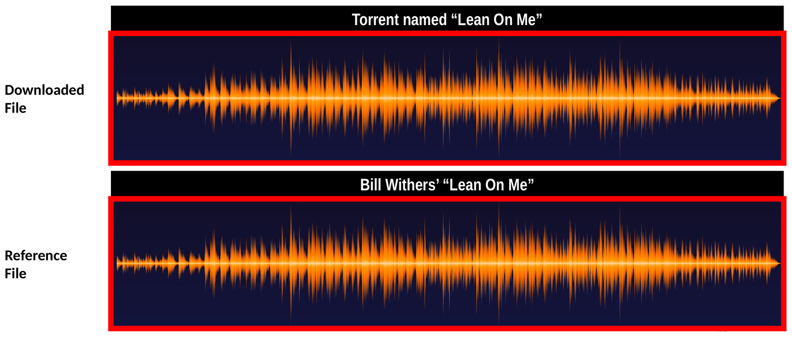
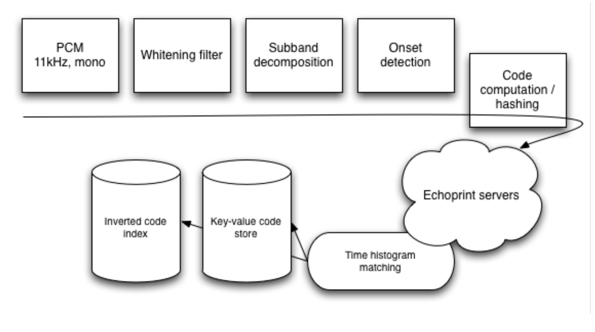
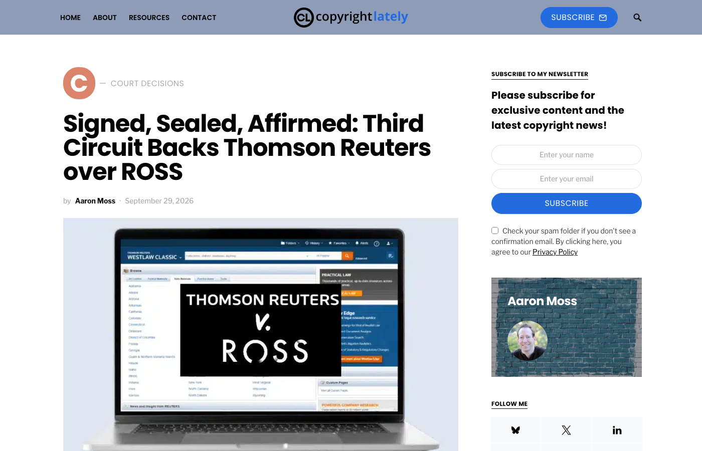
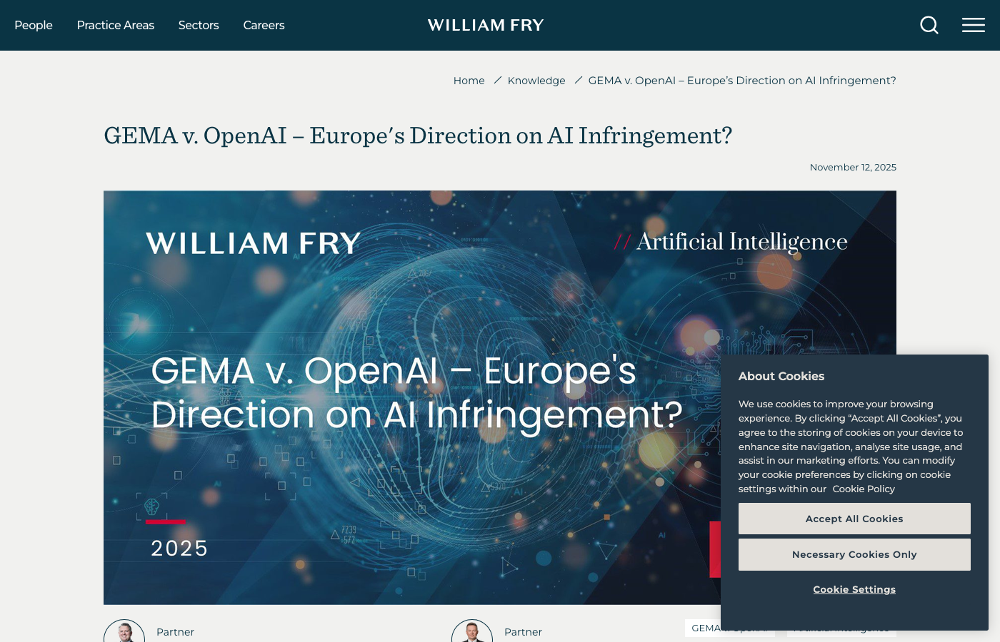
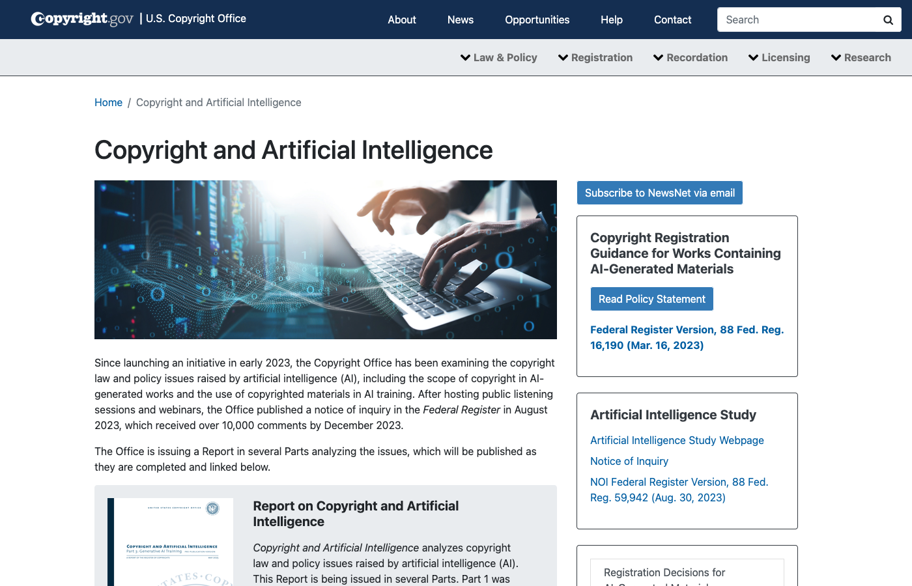
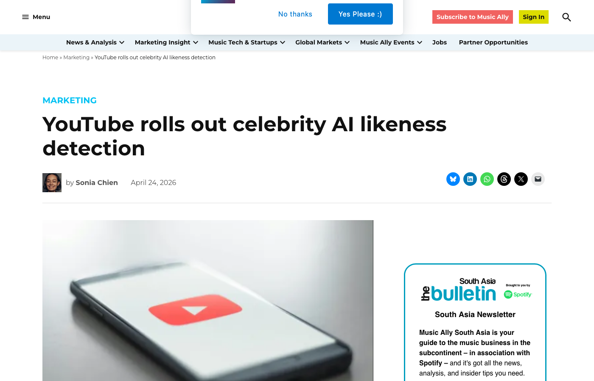

## Copyright Enforcement Meets Generative AI {.center}

The copyright lecture ended with a machine: a notice regime that acts first and
asks later, and automated detectors that compare every upload to a library of
known works. That machine assumes two things: a human made the upload, and the
original exists somewhere to compare against. Generative AI breaks both
assumptions, and the courts, the labels, and the platforms have spent the last
eighteen months deciding what replaces them.

::: {.notes}
Self-contained opener. Two assumptions, both broken: the uploader may be a
model, and the "original" may be inside the model rather than in a reference
library. Everything that follows is one of those two failures. In Autumn 2026
this class was inserted after the copyright lecture because the reading
responses asked for it; the housekeeping about the schedule goes here, not on
the slide.
:::

## Three Questions This Lecture Answers {.smaller}

::: {.columns}
::: {.column width="50%"}
1. **Enforcement or censorship?** The notice regime acts first and asks later;
   a takedown reversed in two weeks has already censored the news cycle
2. **How do the detectors work,** and what does it do with content a machine
   made?
3. **Who owns the output,** and was the training lawful?
:::
::: {.column width="50%"}
- The book's detectors (Content ID, Rights Manager, Audible Magic) are
  **pre-AI**: they compare uploads to a library of references
- Generative models break both ends: the upload may have **no reference**, and
  the reference may be **inside the model**
- A Section 230 coda: the intermediary-liability questions that always come
  up alongside copyright
:::
:::

::: {.notes}
In Autumn 2026: thread 1 was Vibha's and Abani's; thread 2 was Pietro's,
Luke's, Nhi's, and Avni's; thread 3 was a dozen responses (Vivienne, Sandy,
Sabrina, Chris, Daniel, Ajer, Marton, Luca, Margaret). Use names only from the
guide.
:::

# How Content ID Works {.center}

## Three Families of Fingerprint {.smaller}

::: {.columns}
::: {.column width="58%"}
<!-- figure from 03-Platform/01-Platform (ppt-archive/class/platform/09-Platform.pptx slide 20) -->
{width="100%"}
:::
::: {.column width="42%"}
- **Exact hash** (PhotoDNA): is this the same file, bit for bit, after
  normalization?
- **Perceptual hash**: does it *look* the same after resize, recolor,
  recompress?
- **Spectral** (Audible Magic; YouTube's **Content ID**, the copyright
  detector that scans every upload): does it *sound* the same, peak for peak,
  after re-encoding, trimming, renaming?
- The platform stores the fingerprint, not the work, and compares against a
  **reference library** rightsholders upload
:::
:::

::: {.notes}
Pietro asked how it works under the hood; this and the next slide are the
answer. The picture: top is the uploaded file, bottom is the label's reference;
the two spectral envelopes line up. Nothing reads the filename or the lyrics.
:::

## Inside an Audio Fingerprinter {.smaller}

::: {.columns}
::: {.column width="56%"}
<!-- figure from 03-Platform/01-Platform (Echoprint pipeline, The Echo Nest, 2011; via Leiden University) -->
{width="100%"}
:::
::: {.column width="44%"}
- Downsample to **11 kHz mono**, whiten, split into subbands, find note
  **onsets**
- Hash the onset-timing pattern into short **codes**: a song becomes a bag of
  codes
- Lookup: an **inverted index** of codes, then a time-histogram vote picks the
  reference
- The match threshold is a **platform setting**, not law
- A cover with different timing, a parody, a new recording: **no match**
:::
:::

## What the Detector Cannot See {.smaller}

```{dot}
//| fig-width: 12
//| fig-height: 3.6
digraph cannot {
  rankdir=LR; bgcolor="transparent";
  node [shape=box, style="rounded,filled", fontname="Helvetica", fontsize=22, margin="0.25,0.15"];
  edge [fontname="Helvetica", fontsize=18, color="#444444"];
  ranksep=0.5; nodesep=0.3;
  U [label="upload", fillcolor="#eef3fb", color="#4a6fa5"];
  F [label="fingerprint", fillcolor="#eef3fb", color="#4a6fa5"];
  R [label="reference library\n(what rightsholders uploaded)", fillcolor="#fff3e0", color="#ef6c00"];
  M [label="match?", shape=diamond, fillcolor="#eef3fb", color="#4a6fa5"];
  Y [label="claim\n(monetize / track / block)", fillcolor="#fde8e8", color="#b91c1c"];
  N [label="invisible:\nfair use, parody, cover,\nnew work, AI-generated", fillcolor="#e3f1e3", color="#2e7d32"];
  U -> F -> M; R -> M; M -> Y [label="yes"]; M -> N [label="no"];
}
```

- The system answers one question: **have we seen this exact thing before?**
  It has no concept of fair use, context, or intent
- An AI-generated song has **no reference**, so it passes. A model that
  **memorized** a song emits something the detector *does* catch, as a copy of
  the original
- So the detector is blind in one direction and over-eager in the other, and
  the platforms have started building something else (later)

::: {.notes}
This is the hinge slide. Database-bound and context-free, from Meeting 9's
deck that we skipped. Then the two AI failure modes: no reference (novel
synthetic content) and memorization (the GEMA case, coming up).
:::

# AI Meets Copyright {.center}

## Three Questions, Not One {.smaller #threeq}

```{dot}
//| fig-width: 7
//| fig-height: 5.2
digraph threeq {
  rankdir=TB; bgcolor="transparent";
  node [shape=box, style="rounded,filled", fontname="Helvetica", fontsize=22, margin="0.28,0.16"];
  edge [fontname="Helvetica", fontsize=18, color="#444444"];
  ranksep=0.45; nodesep=0.3;
  I [label="1. Input: was training on\nthe work lawful?\n(fair use? licensed? pirated?)", fillcolor="#fff3e0", color="#ef6c00"];
  W [label="2. Inside: does the model\ncontain a copy?\n(memorization)", fillcolor="#eef3fb", color="#4a6fa5"];
  O [label="3. Output: who owns it,\nand does it infringe?\n(authorship, substitution)", fillcolor="#e3f1e3", color="#2e7d32"];
  I -> W -> O;
}
```

::: {.notes}
Three different legal questions that the responses ran together. US courts have
mostly answered 1; Munich answered 2; the Copyright Office and Thaler answered
the first half of 3; nobody has settled the second half.
:::

## Question 1 in US Courts: Training {.smaller}

| Case | Who sued whom | Holding |
|---|---|---|
| **Bartz v. Anthropic** (N.D. Cal., Jun 2025) | Authors vs. Anthropic, for training Claude on their books | Training on books Anthropic **bought** was fair use. Downloading millions of **pirated** books to keep as a library was not. Anthropic settled the piracy claim for **$1.5B**; final approval Jul 20 2026 |
| **Kadrey v. Meta** (N.D. Cal., Jun 2025) | 13 authors vs. Meta, for training Llama on their books | Fair use, because these plaintiffs offered **no evidence** that Llama hurt sales of their books. The judge said a plaintiff who proves the model floods their market would likely win |
| **Thomson Reuters v. Ross** (3d Cir., Sep 29 2026) | Westlaw's owner vs. a startup that copied Westlaw's **headnotes** (short editorial summaries of the point of law in each court opinion) to train a competing legal-search tool | **Not** fair use: the tool was not generative, competed directly with Westlaw, and the headnotes could have been licensed. First appeals-court ruling on AI training |
| **NYT v. OpenAI** (S.D.N.Y.) | The Times vs. OpenAI and Microsoft, for training on its articles and reproducing them | **Undecided**: summary-judgment briefs on fair use complete Nov 6 2026 |

::: {.notes}
Read the holdings column slowly; each is a different reason. Bartz: the act
of training is "quintessentially transformative" (Alsup), but how you got the
copies is a separate question, and the pirated library is what cost $1.5
billion (about $3,000 per work; 91 percent of eligible authors claimed).
Kadrey: not a ruling that training is lawful in general; Chhabria said so
explicitly. The thirteen authors simply did not put in evidence of harm, and
he spent pages explaining how the next plaintiff could. Ross: a headnote is
the one-paragraph summary a Westlaw editor writes above each opinion ("the
court held that..."); Ross used thousands of them as training examples for a
search engine that answered legal questions, i.e. a direct Westlaw substitute,
and the Third Circuit called it "no more than an ordinary copyright case".
NYT: the Cox decision from the copyright lecture already removed the
secondary-liability claims in August 2026; the direct claims are what the
pending motions decide.
:::

## Fair Use's Fourth Factor: Which Market Counts? {.smaller}

Every one of these cases was decided on **fair use**, the defense that excuses
copying. Courts weigh four factors: the purpose of the use (is it
transformative?), the nature of the work, how much was taken, and the **effect
on the market for the original**. The fourth factor decided all three cases,
and the judges disagreed about which market to look at.

::: {.columns}
::: {.column width="55%"}
- **Chhabria (Meta):** the market for *licensing books as training data* is
  circular and does not count; the market the model's **outputs flood** does,
  and a plaintiff who proves that dilution "will often decisively win"
- **Third Circuit (Ross):** a "rapidly developing" **licensing market** for
  training data is real harm; the rightsholder's choice not to license does
  not mean no market exists
- **Alsup (Anthropic):** training is "quintessentially transformative";
  the pirated copies are a separate wrong
- Same statute, same factor, three answers
:::
::: {.column width="45%"}
::: {.capture}
[{width="100%"}](https://copyrightlately.com/thomson-reuters-v-ross-third-circuit/)

Copyright Lately, Sep 29 2026: the Third Circuit affirms in Ross. Click to open.
:::
:::
:::

::: {.notes}
For the breakout: factor four is where every one of these cases was decided.
The censorship angle: if the licensing-market view wins, the right to train
runs through catalogue owners, which is a gate on what models may learn.
:::

## Question 2 in Europe: Is the Model a Copy? {.smaller}

::: {.columns}
::: {.column width="55%"}
- **GEMA v. OpenAI** (Munich, Nov 11 2025; GEMA is Germany's music rights
  society, the ASCAP/BMI equivalent): ChatGPT recited lyrics by
  Grönemeyer and Fischer verbatim; the court held the lyrics were
  **memorized in the weights**, which is a **reproduction** the text-and-data-mining
  exception does not cover. Users are not to blame for simple prompts. Under appeal
- **Munich again, GEMA v. Suno** (Jul 31 2026): same rule for music
- **Getty v. Stability** (London, Nov 4 2025): Stable Diffusion **stores no
  copy**, so it is not an "infringing copy"; appeal granted Dec 2025
- **CJEU, Like Company v. Google:** the Advocate General's opinion treats
  training as within the TDM exception and sits closer to London than Munich
:::
::: {.column width="45%"}
::: {.capture}
[{width="100%"}](https://www.williamfry.com/knowledge/gema-v-openai-europes-direction-on-ai-infringement/)

William Fry, Nov 12 2025, on the Munich ruling. Click to open.
:::
:::
:::

::: {.notes}
A week apart, two courts went opposite ways, and both can be right on their
facts: Munich had evidence of specific memorized works; London found no stored
copies. The hands-on's first experiment is the GEMA test.
:::

## Question 3: Who Owns the Output? {.smaller}

::: {.columns}
::: {.column width="55%"}
- **Human authorship required.** *Thaler v. Perlmutter*: the D.C. Circuit
  (Mar 2025) upheld the Copyright Office's refusal to register an AI-made
  image; the Supreme Court **denied cert on Mar 2 2026**
- **Copyright Office, Part 2** (Jan 2025): prompts alone are not authorship;
  human selection, arrangement, and modification can be
- **Copyright Office, Part 3** (May 2025, pre-publication): training is
  "often transformative" but not automatically fair use; rejects the
  "it learns like a human" analogy; calls for **licensing mechanisms**
- A student's point from the responses: if meaningful human contribution is the
  test, a lot of today's software is on the wrong side of it
:::
::: {.column width="45%"}
::: {.capture}
[{width="100%"}](https://www.copyright.gov/ai/)

copyright.gov/ai, the three-part report. Captured Nov 5 2026; click to open.
:::
:::
:::

::: {.notes}
Chris Deng and Pietro asked whether an AI company can claim rights to a song
its model made: in the US, no one can, unless a human did enough to count. That
is why the labels' deals (next slide) are about the *input* side.
:::

## Music: The Labels Settle, Then Sue Again {.smaller}

**Suno** and **Udio** generate full songs from a text prompt. In June 2024 the
three major labels (Universal, Sony, Warner) sued both for copying the labels'
sound recordings, without permission, to train the models. The settlements
turned the suits into licensing deals: **the label licenses its catalogue to the
service**, the service pays, retrains on licensed material, and keeps outputs
inside a walled garden the label controls.

| When | What happened |
|---|---|
| Oct 29 2025 | **Universal settles with Udio** and licenses Universal's catalogue to it; Udio becomes an opt-in, walled-garden platform (songs stay inside the app) |
| Nov 19 2025 | **Warner settles with Udio**, licensing Warner's catalogue on similar terms |
| Nov 25 2025 | **Warner settles with Suno**: Warner licenses its catalogue; Suno ships licensed models in 2026, phases out the old ones, and buys Songkick from Warner |
| Jun 5 2026 | The musicians' union (**AFM**) sues Universal and Warner for licensing members' recordings into the AI deals without pay or disclosure |
| Sep 2026 | A class of musicians sues Suno over **right of publicity**: the model "encodes their identities" |
| Sep 18 2026 | **Universal and Sony**, who have not licensed anything to Suno, file a new complaint against it over **60,202 specific recordings**; a fair-use ruling in Massachusetts is now a 2027 event |

::: {.notes}
Context the slide cannot carry. Suno and Udio are the two big text-to-music
services; anyone can type "upbeat country song about a truck" and get a
finished track with vocals. The labels' theory is the training theory from the
previous slides: the models learned from licensed recordings without
permission. What changed in late 2025 is that two of the three majors stopped
litigating and started licensing, which is the Third Circuit's "licensing
market" made real: the labels get paid for the input and in return the
services agree to keep outputs inside a walled garden where the label controls
distribution. Sony is the holdout, and the Sep 2026 complaint lists 60,202
specific recordings so the case can proceed on direct infringement rather than
the abstract fair-use question. The two 2026 suits against the labels and
against Suno are the new front: the musicians whose recordings were licensed,
and whose voices the model can imitate, were not at the table. Tie back to
Chris Deng's question (can an AI company own the song?): no, nobody can under
Thaler, so the money is all on the input side. Tie forward: the licensing deal
decides what the model may learn, which is the censorship point on slide 18.
:::

# The Platforms Build Something Else {.center}

## From Content ID to Content Identity {.smaller}

**Content ID** is YouTube's copyright detector: rightsholders upload reference
audio and video, every upload is fingerprinted and compared, and a match
becomes a **claim** (monetize, track, or block) with no person involved. About
2.5 billion claims in 2025. In 2025–26 YouTube built the same machine for a
different reference library: **people**.

::: {.columns}
::: {.column width="55%"}
- **Likeness detection:** a Content-ID-style detector for **faces** in
  AI-generated video. Pilot in 2025; politicians, officials, and journalists
  in spring 2026; entertainers from Apr 21 2026, with CAA, UTA, and WME
- Enrolment needs a government ID and a selfie video; a match hands the
  person a **list** and a choice: privacy removal, copyright removal, or let
  it stand
- A **synthetic-singing** detector inside Content ID is in pilot with labels
- **Labels:** uploaders must disclose realistic synthetic content; the EU AI
  Act's Article 50 transparency duties apply from **Aug 2 2026**
- **Provenance:** C2PA content credentials (an industry standard: a signed
  record of how a file was made and edited, embedded in the file), verifiable
  by anyone, present only if the creator signed (the hands-on)
:::
::: {.column width="45%"}
::: {.capture}
[{width="100%"}](https://musically.com/2026/04/24/youtube-rolls-out-celebrity-ai-likeness-detection/)

Music Ally, Apr 24 2026. Click to open.
:::
:::
:::

::: {.notes}
Say what Content ID is before anything else, since the deck has only described
the fingerprinting underneath it: YouTube's system, launched 2007, rightsholder
references, automatic claims, and the 2025 transparency numbers from Tuesday
(2.5 billion claims, 90 percent monetized rather than removed, under 1 percent
disputed). Nhi asked whether fingerprinting could be built for other media; the
answer arrived this year, for faces and voices, and the reference library is
now a library of *people*. The Baltimore Law Review piece calls it the move from
Content ID to Content Identity. Note the asymmetry with Content ID: a copyright
claim acts automatically; a likeness match hands you a list and waits.
:::

## Two Detectors, Two Defaults {.smaller}

```{dot}
//| fig-width: 12
//| fig-height: 1.6
digraph cid {
  rankdir=LR; bgcolor="transparent";
  node [shape=box, style="rounded,filled", fontname="Helvetica", fontsize=22, margin="0.25,0.15"];
  edge [color="#444444", penwidth=1.5];
  nodesep=0.4;
  T [label="Content ID (2007)", shape=plaintext, fontsize=22];
  A1 [label="rightsholder uploads\nreference works", fillcolor="#fff3e0", color="#ef6c00"];
  A2 [label="match on upload", fillcolor="#eef3fb", color="#4a6fa5"];
  A3 [label="automatic claim: revenue\nredirected or video blocked", fillcolor="#fde8e8", color="#b91c1c"];
  T -> A1 [style=invis]; A1 -> A2 -> A3;
}
```

```{dot}
//| fig-width: 12
//| fig-height: 1.6
digraph lik {
  rankdir=LR; bgcolor="transparent";
  node [shape=box, style="rounded,filled", fontname="Helvetica", fontsize=22, margin="0.25,0.15"];
  edge [color="#444444", penwidth=1.5];
  nodesep=0.4;
  T [label="Likeness detection (2025–26)", shape=plaintext, fontsize=22];
  B1 [label="person enrolls:\nID + selfie video", fillcolor="#fff3e0", color="#ef6c00"];
  B2 [label="match in AI-generated\nvideo", fillcolor="#eef3fb", color="#4a6fa5"];
  B3 [label="a list for the person,\nwho chooses what to do", fillcolor="#e3f1e3", color="#2e7d32"];
  T -> B1 [style=invis]; B1 -> B2 -> B3;
}
```

- Same architecture, opposite defaults. **Content ID acts first:** the claim
  is automatic and the uploader's revenue moves before any person looks.
  **Likeness detection waits:** the match is a notification, and nothing
  happens until the enrolled person asks
- The default is the policy. Automatic enforcement over-removes and favors the
  claimant; a human in the loop under-removes and favors the speaker. YouTube
  chose the first for copyright and the second for faces

::: {.notes}
Walk the two rows top to bottom; they are the same three boxes. The point is
the third box. Ask the room which default they would want for a deepfake of a
candidate posted the week before an election (fast removal matters) and for a
parody of a celebrity (fair use matters), and notice that the answer flips.
That is the Tuesday asymmetry again: whoever designs the default decides who
bears the cost of a mistake.
:::

## AI and Copyright as a Speech Lever {.smaller}

Four ways the AI turn gives copyright new power over what gets published:

1. **Claims at machine scale.** Generative tools make notices as cheap as
   content, and the notice regime already favors the claimant. More claims,
   same asymmetric counter-notice, longer windows of silence
2. **"Made with AI" becomes a category to suppress.** AI-assisted work has
   no owner to defend it (*Thaler*; Copyright Office Part 2), platforms must
   label or demote synthetic content (EU AI Act Art. 50; YouTube's labels),
   and publishers set AI-use rules for what they will print. A detector's
   false positives land on legitimate speech, exactly as Content ID's do
3. **Pre-emptive refusal.** After GEMA, models refuse whole categories
   (lyrics, long passages) rather than risk a claim. The suppression moves from
   the takedown to the model's policy, invisible to the user (the memorization
   test)
4. **Licensing as a gate on learning.** If training requires a licence,
   catalogue owners decide what a model may learn, and what it never learned it
   cannot surface: the filter bubble at the training stage, with the same
   measurement problem

::: {.notes}
Point 2 is the one to argue: a rule that AI-assisted content is unprotected,
or must be labelled, or will not be published, is a rule about a category of
speech, and the category is decided by a detector with a false-positive rate.
The course book is the example in point 2: a university press working out
what AI assistance it will accept in a manuscript is deciding what gets
published. Point 3 is the hands-on: try a GEMA artist and a US artist and see
which the model refuses. Point 4 connects to personalization (Meeting 10):
what a model never learned is as invisible as what a feed never showed.
:::

## Section 230: Three Questions That Always Come Up {.smaller}

**Section 230** (1996) says a platform is not the publisher of what its users
post, and may moderate without becoming one. Copyright is the big exception:
the DMCA, not §230, governs it. Three questions students raise every year:

- **Was there ever a precedent for "not responsible for what you distribute"?**
  Yes. *Smith v. California* (1959): a bookseller cannot be convicted for an
  obscene book he had not read. Then *Stratton Oakmont v. Prodigy* (1995) made
  a forum that *moderated* liable as a publisher, which punished moderation;
  §230 was written the next year to reverse that
- **Could the law require platforms to be politically neutral?** Texas and
  Florida tried in 2021, banning removal "based on viewpoint". *Moody v.
  NetChoice* (2024) held that choosing what to carry is the platform's own
  protected speech, and the laws also fail in practice: is "anti-vaccine" a
  viewpoint or a policy violation? Which state's law governs a travelling user?
- **Should platforms be common carriers, obliged to carry everyone?** The
  net-neutrality argument, made for the pipes since the 2000s and now made for
  the platforms. The next lecture takes it up for the pipes

::: {.notes}
Context for each. First bullet: the distributor/publisher distinction is older
than the Internet; §230 restored the distributor's position for anyone who
moderates. Second: HB 20 and SB 7072; the Supreme Court remanded for a
feature-by-feature analysis, so the laws are not dead, but the core holding is
that curation is speech. Florida's law fines platforms $250,000 a day for
deplatforming a statewide candidate. Third: the common-carrier framing is the
hinge to the economics-of-access lecture.
:::

## Hands-On: Can the System Tell? {.smaller}

Three experiments, in pairs, twenty minutes
([instructions](../../../activities/ai-copyright.md)):

1. **Does the model recite?** Ask two chatbots for the lyrics of "Let It Be"
   and of a Grönemeyer song, then for the first paragraph of *Harry Potter*.
   Recited, quoted, summarized, or refused? Is the rule about lyrics, about
   copyright, or about one rightsholder?
2. **Does the file say where it came from?** Generate an image in ChatGPT or
   Gemini, download it, and check it at the C2PA verifier
   (verify.contentauthenticity.org). Then check a screenshot of it, and a
   photo from your phone
3. **Does the fingerprinter recognize it?** Open a "Suno AI song" video on
   YouTube: is the synthetic-content label there? Play it and run Shazam.
   Then do the same with a released song

**Report back:** the one result that surprised you, and whether it moves you
toward "the detectors can handle this" or "they were built for a world that no
longer exists."

**Discussion, as time permits:** [should training a model on a work require a licence?](../../../breakouts/copyright.md)

::: {.notes}
Autumn 2026 logistics: Tuesday Nov 10 is the economics of access (net
neutrality, zero rating, demonetization, book 4.3–4.5); the week-7 response
(4.4–4.5) is due Tuesday 9 am. Expect the memorization test to split by model
and by rightsholder, which is the GEMA point from slide 12.
:::
