## How Do We Know? {.center}

Information control is often **designed to look like an ordinary network failure**.

This lecture is about **measurement** — turning anecdotes into evidence, and
telling **censorship from breakage**.

::: {.notes}
Open with the core epistemic problem of the whole chapter. A page won't load. Is
that a censor, a misconfigured resolver, an expired cert, or a bad upstream link?
The entire field of censorship measurement exists to answer that question rigorously.
This is Ch. 5 of the book — the "how we know" chapter that sits between the
mechanisms (Ch. 2-4) and circumvention (Ch. 6).
:::

## Why Measure Information Control?

- **Mitigation** — to circumvent control, first understand *where, when, how* (Ch. 6)
- **Variation** — is it uniform across a country? across regimes? does it spike on
  **sensitive dates** (Tiananmen anniversary) or around **elections and protests**?
- **Explanation** — tie a regime's *type* to its *methods*; complements or substitutes?
- **Diffusion** — China as the "thought leader" in repression; techniques spread

::: {.notes}
Book §5.1. Frame measurement as serving both engineers (circumvention) and social
scientists (political science theories about how regimes behave). The political-science
questions are real research questions: do authoritarian regimes that allow elections
censor differently? Does a state ever have an incentive to *decrease* censorship?
Large-scale measurement is how we test theories built from small case studies.
:::

## A Tax We Have to Detect

Recall the course thesis: information control is a **tax on access to information** —
often **friction**, not an outright wall.

That makes it **hard to measure**:

- **Hidden** — deniable; "just a network problem"
- **Intermittent** — switched on for an election, off afterward
- **Hyper-localized** — one ISP, one region, one app

::: {.notes}
Connect back to Roberts's friction/flooding framing from the intro deck. Friction is
*designed* to be ambiguous — that ambiguity is a feature for the censor and a problem
for the measurer. Everything in this chapter is a response to hidden, intermittent,
hyper-localized control.
:::

## A Maturing Measurement Ecosystem {.smaller}

| Project | Where it looks from | What it sees | Since |
|---|---|---|---|
| **OONI** | Volunteers' phones and laptops, *inside* | Site and app reachability, per network | 2012 |
| **Censored Planet** | Remote, via infrastructure *inside* | DNS, TCP/IP, HTTP/S interference | 2018 |
| **IODA** | Outside: routing, probing, telescope | Connectivity outages | CAIDA → Georgia Tech |
| **Cloudflare Radar** | A CDN's own traffic | Traffic drops, shutdowns | 2020; outage center 2022 |
| **GFWatch** | A U.S. vantage point, *into* China | Great Firewall DNS poisoning | USENIX Sec. '21 |

No single project answers "is it censored?" **Different vantage points, different blind spots.**

::: {.notes}
Book §5.1. Talk through the map row by row, then the point: what grew up over the last
decade is an ecosystem, not a tool. Talk about how in-country probes (OONI) and remote
measurement (Censored Planet) complement each other, and where your own work fits (Iris,
the IP-ID side channel, Encore; how those ideas became Satellite and Augur). Then the
outage layer (IODA, Radar) that answers a different question: is the network up at all?
GFWatch is the single-country, single-mechanism specialist. Check gfwatch.org before
class; its continued operation in 2026 was not verified.
:::

## OONI: The Workhorse {.smaller}

The **Open Observatory of Network Interference** — volunteers run **OONI Probe**, which
runs a suite of tests and uploads results to open data.

::: {.columns}
::: {.column width="42%"}
- **Web connectivity** — is a site reachable?
- **Instant messaging** — WhatsApp, Signal, Telegram
- **Circumvention** — Tor, Psiphon, VPNs
- **Performance** — speed, video quality

**3 billion+ measurements** since 2012 from **30,000 networks in 245 countries and
territories**. *(OONI, 2026)*
:::
::: {.column width="58%"}
::: {.capture}
[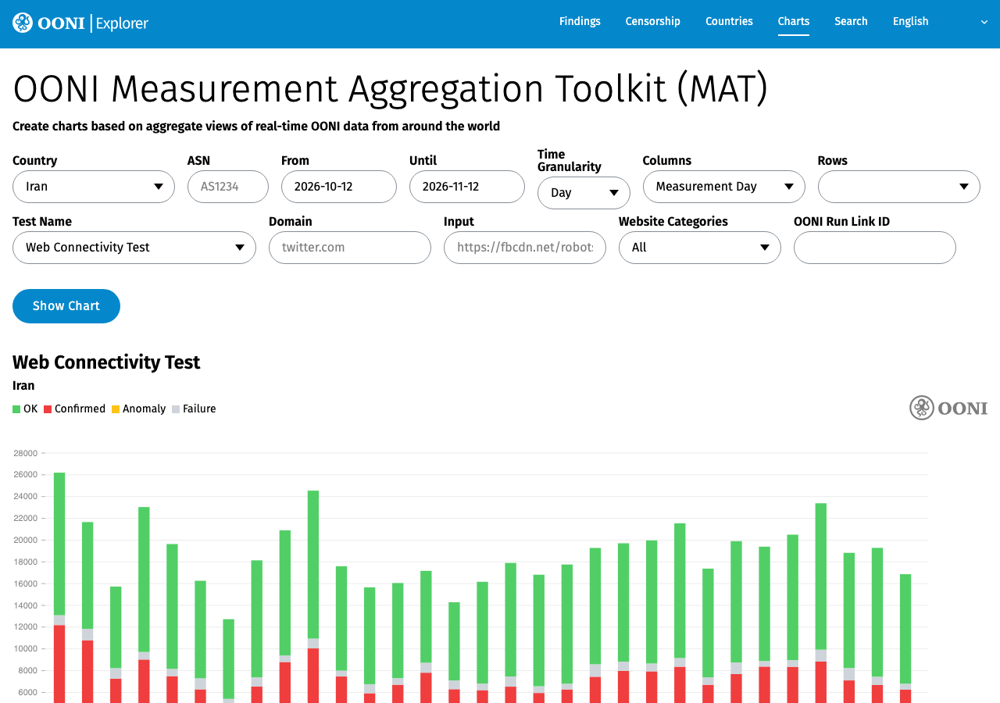{width="100%"}](https://explorer.ooni.org/chart/mat?probe_cc=IR&test_name=web_connectivity&since=2026-10-12&until=2026-11-12&axis_x=measurement_start_day)

OONI Measurement Aggregation Toolkit: web-connectivity results from Iran, the last 30 days, confirmed blocks vs. anomalies vs. OK. Captured Nov 12 2026; click to open.
:::
:::
:::

::: {.notes}
Book §5.1. OONI is the leading open-source tool and the one we'll use hands-on. Key
design point: it's open data — anyone can audit and replot. The Measurement Aggregation
Toolkit (MAT) at explorer.ooni.org/chart/mat lets you visualize confirmed blocks vs.
anomalies vs. failures over time. 2026 scale (OONI's trends report): about 180 countries
a month, tens of millions of new measurements a month. Talk about what volunteer probes
buy you (real users' networks, apps not just websites) and what they cost (someone in
the country has to take the risk). Hands-on preview.
:::

## Remote Measurement: Censored Planet {.smaller}

No volunteers: measure **from outside**, through **infrastructure inside** the country.

::: {.columns}
::: {.column width="48%"}
- **Satellite** — DNS, via open resolvers
- **Augur** — TCP/IP reachability, via the IP-ID side channel
- **Hyperquack** — HTTP/S keyword filtering, via echo and discard servers

Running since **August 2018**; **95,000+ vantage points in 221 countries** *(CCS 2020)*.
Satellite and Hyperquack data are public; **Augur's is not**.

How each technique works: Part 2 of this deck. *(Book §5.2)*
:::
::: {.column width="52%"}
::: {.capture}
[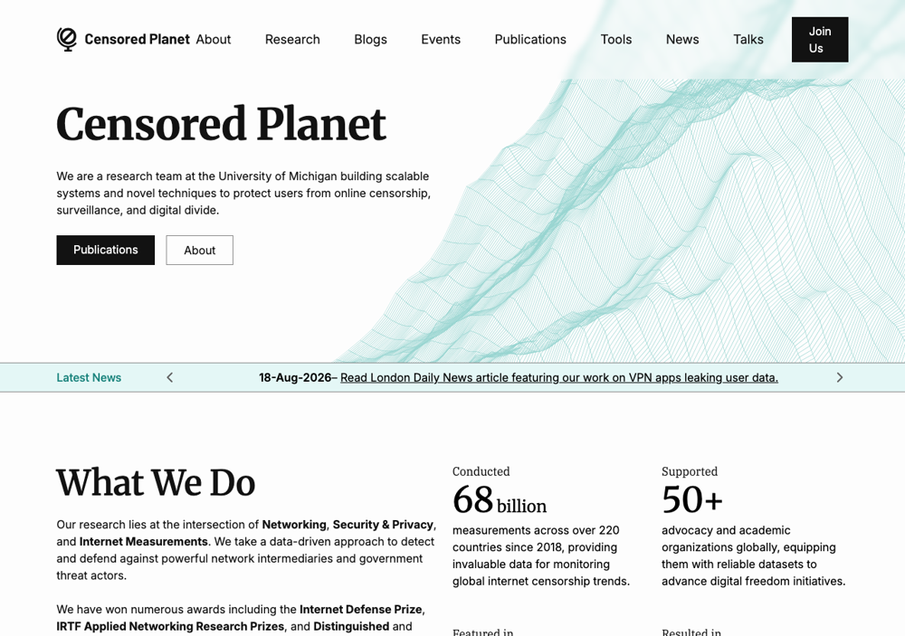{width="100%"}](https://censoredplanet.org/)

censoredplanet.org, the project page and data access. Captured Nov 12 2026; click to open.
:::
:::
:::

::: {.notes}
Book §5.1. Talk about how OONI and remote measurement complement each other: OONI is deep
but sparse (where volunteers are), Censored Planet is broad and continuous but sees
infrastructure, not users. Your own Iris / IP-ID / spooky-scan work as the lineage. Scale
figures are dated (CCS 2020; Release 2.0 docs, about 2022, cite 60 billion+ data points);
no current 2026 count was found. Data access point: an ACSAC 2024 paper notes Augur data is
not released. Ask: what does it mean for a field when one technique's data stays private?
:::

## Outage Signals: IODA and Cloudflare Radar {.smaller}

::: {.columns}
::: {.column width="50%"}
**IODA** *(Georgia Tech, from CAIDA)*

- **BGP** — are the country's routes still announced?
- **Active probing** — do address blocks still answer?
- **Network telescope** — is background traffic still arriving?
- Flags an outage when **two or more signals** drop
:::
::: {.column width="50%"}
**Cloudflare Radar**

- A CDN's view: **its own traffic** by country and network
- Quarterly **disruption summaries**
- **2025:** almost half of **174 major outages** were **government-directed shutdowns**
:::
:::

::: {.vignette}
**Q3 2026:** Radar logged **49 disruptions**, including **18 exam-season shutdowns in Iraq**
and a **10-day shutdown in Tigray** as fighting resumed. *(Cloudflare Radar via TelcoNews, Oct 2026)*
:::

::: {.notes}
Book §5.1. These answer a different question from OONI: not "is this site blocked?" but
"is the network up at all?" Talk about why a shutdown is the easy case to see and the
hard case to attribute (cable cut? power? government?), and why IODA wants two signals.
Radar's 2025 Year in Review is the source for the 174 figure; exam shutdowns are a big
share. Q3 2026 figures came from secondary coverage; check the Cloudflare blog post
before class. Next slide: Google's version of the same idea.
:::

## The Outage Dashboards {.smaller}

::: {.capture}
[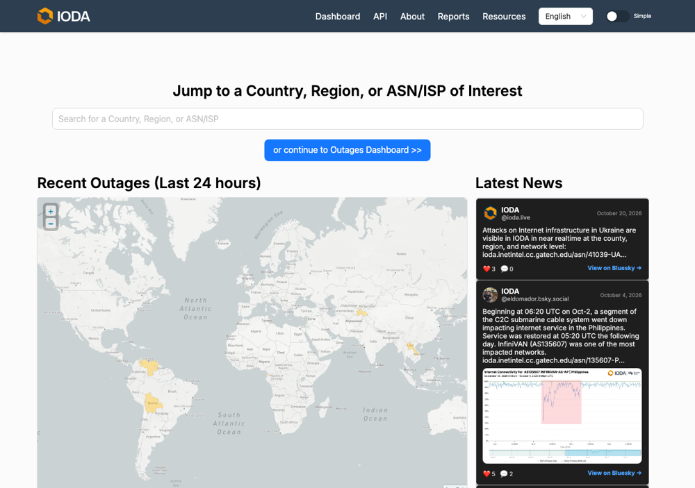{height="400px"}](https://ioda.inetintel.cc.gatech.edu/)

IODA (Georgia Tech): BGP, active probing, and telescope signals per country, with the last 24 hours of outages on the map. Captured Nov 12 2026; click to open.
:::

Also live: the [Cloudflare Radar Outage Center](https://radar.cloudflare.com/outages). Both answer "is the network up?", not "is this site blocked?"

::: {.notes}
Two live dashboards, one minute each. IODA: pick a country with a recent event and show the
three signal rows and the alert band. Radar: the outage list with the "government-directed"
tag. Say what neither can see: a single blocked site on a network that is otherwise up.
:::

## Google Transparency Report: A Bellwether {.smaller}

::: {.columns}
::: {.column width="45%"}
Google's **Traffic** report tracks fluctuations in traffic to Google services — a
**black-box signal** that something is disrupting reachability.

- Specific to **Google services**, but a useful **bellwether** for broader disruption
- Best when it **corroborates** an independent measurement
:::
::: {.column width="55%"}
::: {.capture}
[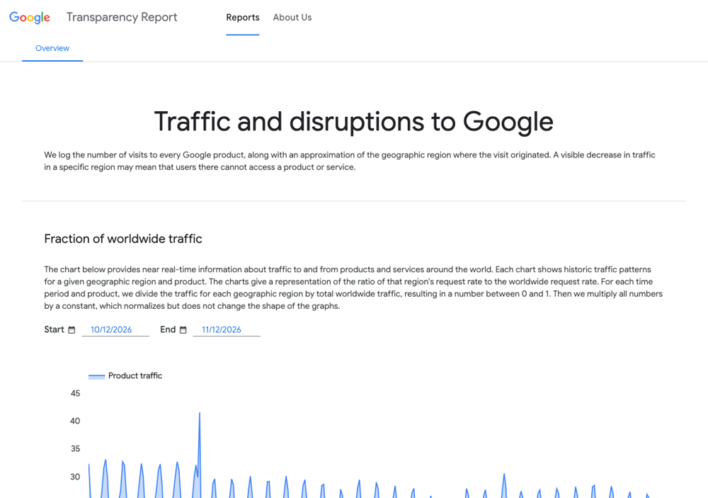{width="100%"}](https://transparencyreport.google.com/traffic/overview)

Google Transparency Report, Traffic and disruptions: per-product traffic by region. Captured Nov 12 2026; click to open.
:::
:::
:::

::: {.notes}
Book §5.1. Contrast with OONI: Google sees its own traffic dip but can't tell you
exactly *what* a censor did. It's a coarse, deniable-from-the-outside signal. The power
comes from triangulation — when Google's traffic dip lines up with OONI's confirmed
blocks, you have two independent witnesses. That's the next slide.
:::

## Case Study: Uganda 2021

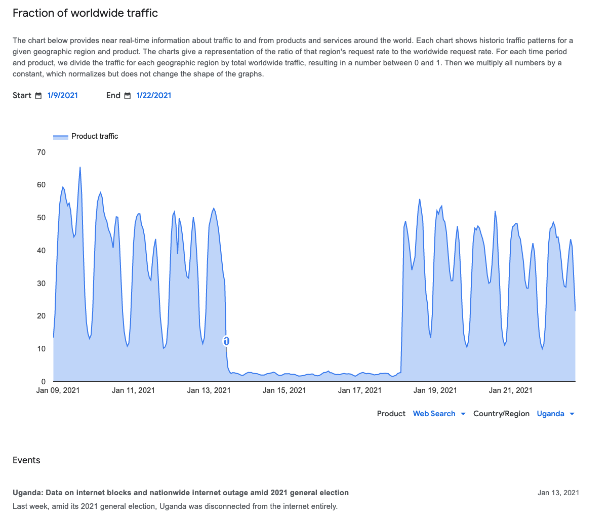

OONI showed **per-ISP social-media blocks** over the same window. Two independent
methods, **same event** — that corroboration is the gold standard.

::: {.vignette}
History rhymes: after Uganda's **January 2026 general election**, OONI again documented
**blocking of WhatsApp and Facebook** on Ugandan networks — the same election-time
playbook, five years later. *(OONI, 2026.)*
:::

::: {.notes}
Book §5.1 walks through the 2021 Uganda shutdown. The teaching point is corroboration:
Google's traffic graph (this image) shows the macro dip; OONI shows which ISPs blocked
which apps. The 2026 repeat is the live hook — same country, same playbook, freshly
documented. Swap the vignette each year for the freshest election-time block OONI
documents. Source: OONI 2026 "Measuring Internet Censorship" report.
:::

## Triangulation and Its Limits {.smaller}

**Agreement across independent vantage points** is the evidence. But each witness has gaps:

```{dot}
//| fig-width: 12.4
//| fig-height: 4.2
digraph g {
  rankdir=LR; nodesep=0.3; ranksep=0.55; bgcolor="transparent";
  node [shape=box, style="filled,rounded", fontname="Helvetica", fontsize=18,
        color="#555555", penwidth=1.4, margin="0.16,0.08", fillcolor="#cfe3f5"];
  edge [color="#555555", penwidth=1.5, fontname="Helvetica", fontsize=16];
  ev [label="An event:\na site unreachable,\ntraffic drops", fillcolor="#f2d9a8"];
  ooni [label="OONI probes\ngap: volunteers are uneven;\nsome countries have none"];
  goog [label="Google traffic\ngap: Google services only;\ncoarse and black-box"];
  ioda [label="IODA, Radar\ngap: small shutdowns stay below\nthresholds; Iran left BGP up"];
  plat [label="Platform data\ngap: sees the most,\nshares the least"];
  ag [label="Witnesses agree:\nthat is the evidence", fillcolor="#d9efd3"];
  ev -> {ooni goog ioda plat} -> ag;
}
```

And a growing ambiguity: **TLS interference** looks like ordinary failure *(OONI, 2026)*.

**Discuss:** When OONI, IODA, and Radar disagree about an event, whom do you believe, and
what would you need to see?

::: {.notes}
Book §5.1. Talk about triangulation as the field's core method and Uganda as the example
just shown. Then walk the limits: each one is a place a censor can hide. Sources for the
two dated claims: FOCI 2026 paper on shutdowns below IODA's thresholds; arXiv 2605.00187
on Iran's 2025–26 shutdowns without routing withdrawal. Data access: Augur not public;
platform data getting harder (CrowdTangle, later in the deck). Let the discussion run;
it sets up the recipe.
:::

## A Recipe: Investigating a Suspected Block {.smaller}

The book's five-step walkthrough — "is **example-news.org** blocked in Country X?"

```{dot}
//| fig-width: 12.4
//| fig-height: 4.4
digraph g {
  rankdir=LR; nodesep=0.3; ranksep=0.55; bgcolor="transparent";
  node [shape=box, style="filled,rounded", fontname="Helvetica", fontsize=18,
        color="#555555", penwidth=1.4, margin="0.16,0.08", fillcolor="#cfe3f5"];
  edge [color="#555555", penwidth=1.5, fontname="Helvetica", fontsize=16];
  h [label="1. Falsifiable hypothesis\nname the ISP, the protocol,\nthe expected failure", fillcolor="#f2d9a8"];
  v [label="2. Vantage points\nOONI probe? VPS in-country?\nside channel? a volunteer?"];
  t [label="3. The right tests\nDNS → TCP → TLS → HTTP,\neach against a control"];
  d [label="4. Blocking or breakage?\nrepeat across ISPs,\nover time, with controls", fillcolor="#f8d7c4"];
  c [label="5. Conservative claim\nthese networks, this window,\nnot \"Country X censors\"", fillcolor="#d9efd3"];
  h -> v -> t; t -> d [constraint=false]; d -> c;
  {rank=same; h; d;} {rank=same; v; c;}
}
```

Most mistakes happen at step 4: a failure is not censorship until the controls say so.

::: {.notes}
Book §5.1 "A Walkthrough." This is the spine of the whole chapter and the most
important slide for students doing projects. Emphasize Step 4: the most common student
mistake is treating *any* failure as censorship. Three checks: multiple ISPs (country
policy is consistent; a local outage isn't), repeat over time (transients decay), and a
control set of unrelated sites (if *everything* is broken, you're measuring a network
failure). Step 5 is about scientific humility — bound your claim to the networks and
window you observed.
:::

# Measuring Technical Controls {.center}

DNS · TCP/IP · Web — *(censorship-book §5.2)*

## Where a Censor Can Intervene

::: {.columns}
::: {.column width="60%"}
<!-- recovered from ppt-archive/class/measurement/02-Measurement.pptx slide 5 -->
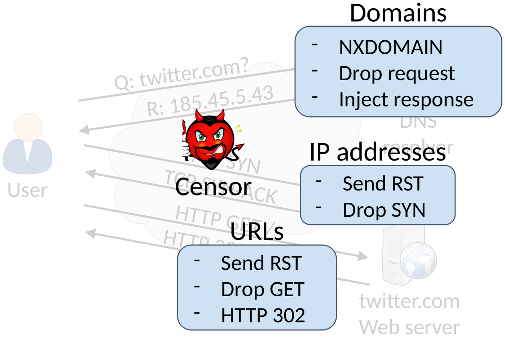
:::
::: {.column width="40%"}
- One fetch of `twitter.com` crosses **three layers**: DNS lookup, TCP handshake, HTTP request
- **Domains**: NXDOMAIN, dropped query, or an injected answer
- **IP addresses**: RST injection or a silently dropped SYN
- **URLs**: RST, dropped GET, or an HTTP 302 to a block page
:::
:::

::: {.notes}
Recovered from the original pptx; the callouts used to fly in one layer at a time, so walk
the picture top to bottom. The greyed exchange behind the callouts is the normal fetch:
DNS query and answer, SYN and SYN-ACK, GET and 200 OK. Each callout is the censor's menu
at that layer, and each item leaves a different fingerprint: an NXDOMAIN looks like a
typo, an injected RST looks like a flaky server, a 302 is the only one that admits what it
is. The next three parts of the deck measure each layer in turn.
:::

## Measuring DNS Manipulation: The Hard Part

**Strawman:** look up a domain from many resolvers; flag answers that disagree with the
"right answer."

**Problem:** there is **no single right answer**. Three causes of inconsistency:

```{dot}
//| fig-width: 12.4
//| fig-height: 3.6
digraph g {
  rankdir=LR; nodesep=0.3; ranksep=0.55; bgcolor="transparent";
  node [shape=box, style="filled,rounded", fontname="Helvetica", fontsize=18,
        color="#555555", penwidth=1.4, margin="0.16,0.08", fillcolor="#cfe3f5"];
  edge [color="#555555", penwidth=1.5, fontname="Helvetica", fontsize=16];
  q [label="Look up one domain\nfrom many resolvers", fillcolor="#f2d9a8"];
  a [label="The answers\ndisagree"];
  c1 [label="Censorship\ninjected or withheld answer", fillcolor="#f8d7c4"];
  c2 [label="Misconfiguration\nbenign"];
  c3 [label="Load balancing, CDNs\ndifferent by design", fillcolor="#d9efd3"];
  w [label="Which one?", fillcolor="#f8d7c4", style="filled,rounded,dashed", fontcolor="#a03030"];
  q -> a; a -> {c1 c2 c3}; {c1 c2 c3} -> w [style=dashed];
}
```

::: {.notes}
Book §5.2. This is the central difficulty of DNS measurement. Popular services
deliberately return different IPs to different users for performance. So "responses
disagree" is the *normal* case, not evidence of censorship. Set up the next slide: the
Google map shows just how much legitimate variation exists.
:::

## No Single Right Answer

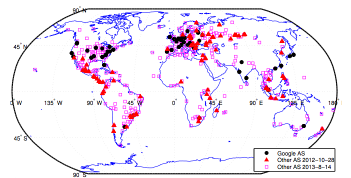

Google returns a nearby **front-end** IP to each user. Hundreds of valid answers — and
this map is nearly a decade old; replication is far broader now.

::: {.notes}
Book §5.2, Figure (google-frontend). Every dot is a *legitimate* answer for google.com.
This is why "the IP differs" can't mean "censorship." Drive home: the measurement
challenge is separating this legitimate spread from manipulation.
:::

## Consistency + Verifiable Checks {.smaller}

Since no single check is decisive, look for **multiple checks failing together**.

```{dot}
//| fig-width: 12.4
//| fig-height: 3.9
digraph g {
  rankdir=LR; nodesep=0.3; ranksep=0.55; bgcolor="transparent";
  node [shape=box, style="filled,rounded", fontname="Helvetica", fontsize=18,
        color="#555555", penwidth=1.4, margin="0.16,0.08", fillcolor="#cfe3f5"];
  edge [color="#555555", penwidth=1.5, fontname="Helvetica", fontsize=16];
  s [label="An answer differs from\nother vantage points", fillcolor="#f2d9a8"];
  k1 [label="Consistency checks\nsame AS? same reverse DNS?\nsame HTTP content?"];
  k2 [label="Verifiable check\nTLS certificate: right domain,\ntrusted CA, currently valid?"];
  ok [label="Valid certificate:\nlegitimate variation\n(a CDN front end)", fillcolor="#d9efd3"];
  bad [label="Checks fail together,\nor the cert is self-signed\nor for the wrong domain:\nmanipulation", fillcolor="#f8d7c4"];
  s -> k1 -> k2; k2 -> ok; k1 -> bad; k2 -> bad;
}
```

A valid, browser-trusted certificate for the right domain needs **no cross-comparison** —
it verifies on its own.

::: {.notes}
Book §5.2. Two flavors of check. Consistency = compare across vantage points (weak
individually, strong when several fail at once — e.g., different IP *and* different AS
*and* a self-signed cert). Independently verifiable = the TLS cert stands alone: there's
no good reason a real service hands out a different cert per vantage point. Example from
the book: reverse lookup of a google.com IP yields ...1e100.net, Google's hosting domain —
a clue, not proof.
:::

## DNS Manipulation: Prevalence

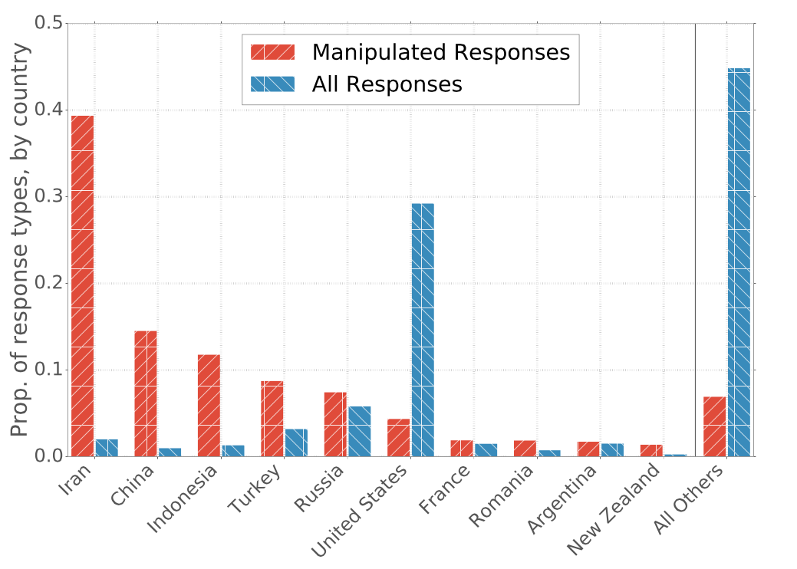

- **Iran, China, Indonesia, Turkey, Russia** stand out
- Manipulation is **not uniform within a country** — some resolvers manipulate ~none,
  others ~80% of tested domains
- Targets: **gambling, pornography, P2P, social media, video**

**Encrypted DNS** (DoH / DoT) raises the cost of this manipulation — so censors now
measurably **block the encrypted resolvers** too *(see Ch. 2 / the Circumvention deck)*.

::: {.notes}
Book §5.2, Figure (iris-results). Note the *within-country* variation — it's not a
national monolith; individual resolvers differ wildly. That's either a measurement
artifact or a real manifestation of porous censorship. Honest answer from the study: we
don't fully know. Good moment to model scientific humility. Encrypted-DNS tie-in: DoH/DoT
hide the plaintext lookups that DNS injection targets, so they're a circumvention move —
which is why measurement studies now track *blocking of the encrypted resolvers
themselves*. Recent work (e.g., Li et al. 2024) found ~6% of encrypted DNS queries
censored globally but ~36% from inside China; DoT/DoH/DoQ are widely blocked in censored
regions. Cross-link to Ch. 2 (encrypted DNS mechanics) and Ch. 6 (circumvention) — don't
re-teach the protocol here.
:::

## Measuring TCP/IP: The Vantage-Point Problem

To test whether **Origin → Target** is blocked, you usually need a machine **inside** the
censoring country. You rarely have one.

**Idle scan / "spooky scan"** turns an ordinary in-country host (a **reflector**) into an
unwitting vantage point — using a **side channel**.

```{dot}
//| fig-width: 12.4
//| fig-height: 3.4
digraph g {
  rankdir=LR; nodesep=0.3; ranksep=0.55; bgcolor="transparent";
  node [shape=box, style="filled,rounded", fontname="Helvetica", fontsize=18,
        color="#555555", penwidth=1.4, margin="0.16,0.08", fillcolor="#cfe3f5"];
  edge [color="#555555", penwidth=1.5, fontname="Helvetica", fontsize=16];
  subgraph cluster_out { label="Outside"; style=dashed; color="#999999"; fontname="Helvetica"; fontsize=16;
    m [label="Measurer\n(your machine)", fillcolor="#f2d9a8"]; }
  subgraph cluster_in { label="Censoring country"; style=dashed; color="#999999"; fontname="Helvetica"; fontsize=16;
    r [label="Reflector\nany host with a global\nIP ID counter"]; }
  t [label="Target site", fillcolor="#d9efd3"];
  cen [label="Censor", shape=diamond, fillcolor="#f8d7c4", margin="0.05,0.02"];
  m -> r [label="1, 4: probe; read the IP ID"];
  m -> t [label="2: SYN, spoofed as\nthe reflector", style=dashed];
  t -> cen [label="3: SYN-ACK"]; cen -> r;
  r -> cen [label="RST (IP ID +1)"]; cen -> t;
}
```

::: {.notes}
Book §5.2 "Measuring TCP/IP Manipulation." This is the cleverest technique in the
chapter and worth slowing down for. The vantage-point problem is fundamental: you can't
get probes everywhere, especially not in the countries you most want to measure. Side
channels are the workaround — and they're also the source of the ethics debate later.
:::

## The IP ID Side Channel {.smaller}

Many hosts stamp every outgoing packet with a **global, incrementing IP ID** counter.
Watch the counter remotely and you can infer **how many packets the host sent**.

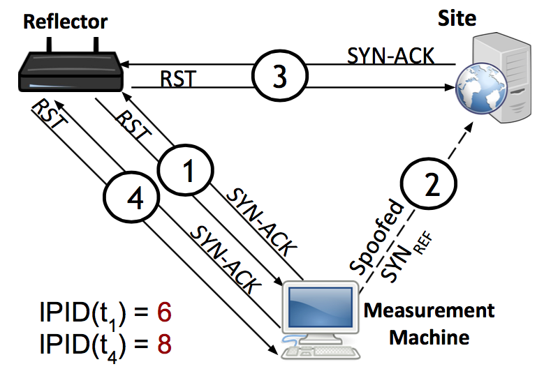

::: {.notes}
Book §5.2, Figure (spooky scan). Walk the four steps on the image:
(1) probe reflector → learn IP ID = 6;
(2) send a SYN to the Site *spoofed* to look like it came from the reflector;
(3) Site replies SYN-ACK to the reflector, which sends a RST (incrementing its IP ID);
(4) probe reflector again → IP ID = 8, so a packet got through → no block.
Two conditions: the IP ID must be (a) sequential and (b) global, not per-connection.
:::

## Reading the Counter: Forward vs. Reverse

- **No blocking** — full handshake; reflector sends RST; **IP ID jumps**
- **Forward blocked** — SYN never reaches Target; no SYN-ACK; **IP ID flat**
- **Reverse blocked** — SYN-ACK can't get back to reflector; **IP ID flat**

Detection is **statistical** — hypothesis testing over many trials against background
noise. Validated against **known blocklists** (Citizen Lab) and known-blocked Tor bridges.

::: {.notes}
Book §5.2. The signal is noisy — background traffic also bumps the IP ID — so you run
many randomized trials and use a likelihood-ratio test. Validation matters: the method
was checked against ground truth (Citizen Lab block lists, Tor bridges known to be
blocked in China). Ethics preview: the book restricts reflectors to *infrastructure*
machines to avoid implicating individuals — that's the bridge to the ethics section.
:::

## Idle Scan: The Two Blocked Cases

<!-- recovered from ppt-archive/class/measurement/02-Measurement.pptx slide 21 -->
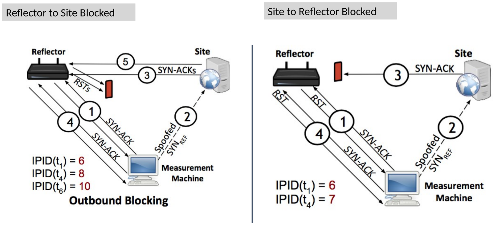{width=82%}

::: {.notes}
Companion to the no-blocking figure two slides back. Walk both panels with the same
numbered steps: probe the reflector (1), send the spoofed SYN (2), watch what comes back
(3), probe again (4). Left panel: the site answers with SYN-ACKs, the reflector tries to
RST them, the RSTs are dropped on the way out, and the site retransmits, so the reflector
keeps sending RSTs and the IP ID climbs by two or more. Right panel: the SYN-ACK is
dropped inbound, the reflector never sends anything, and the IP ID rises only by the one
packet it sends to us. Three outcomes, three counter signatures; the hypothesis test on
the earlier slide is how you tell them apart under background noise.
:::

## Measuring Web Filtering: Encore {.smaller}

**Encore** makes the user's **browser** the vantage point. A site running Encore serves
JavaScript that asks the browser to load an object from a **third-party** target.

- Blocked by the **same-origin policy** from *reading* cross-origin data...
- ...but **resource embedding** (``, `<style>`, `<iframe>`) is looser
- `onload` / `onerror` leak the **one bit** Encore needs: did it load?

Many images, same domain failing → **domain blocked**; same IP failing → **IP blocked**.

::: {.notes}
Book §5.2 "Measuring Web Filtering." Encore exploits the same mechanism that powers
Facebook Like buttons and analytics — the web is *built* on cross-origin requests.
Encore doesn't need to read the response (the same-origin policy forbids that); it only
needs success/failure, which onload/onerror provide. By varying what it loads (same
domain vs. same IP vs. same URL) it infers the *granularity* of blocking. This is the
most ethically contested tool in the chapter — flag it now.
:::

## How Encore Works

<!-- recovered from ppt-archive/class/measurement/02-Measurement.pptx slide 31 -->
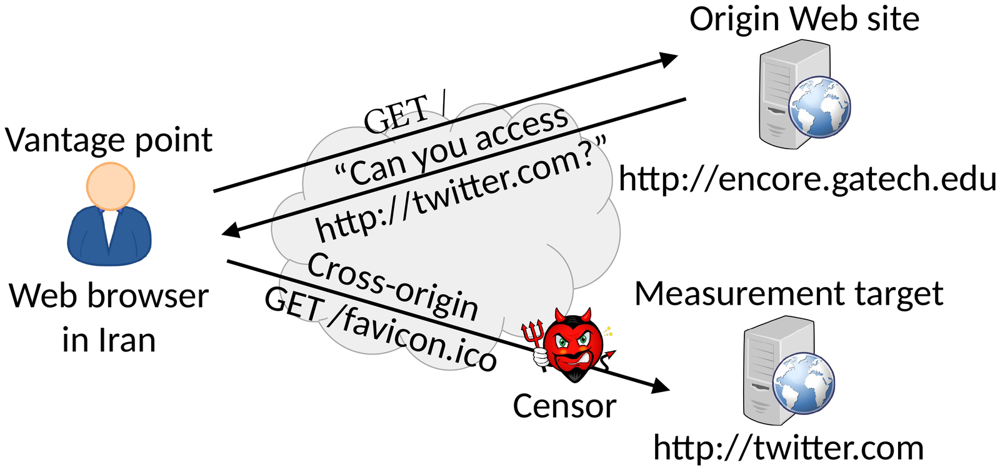{width=72%}

- A browser in Iran fetches an ordinary page from the **origin** site, which carries Encore's script
- The script asks the browser to load one object **cross-origin** from the **measurement target**
- The censor sits only on the second path; whether that request **loads or fails** is the measurement

::: {.notes}
Recovered from the original pptx. Three parties: the vantage point (any browser that
happens to visit the origin), the origin site that serves the Encore snippet, and the
measurement target behind the censor. The top pair of arrows is a normal page load. The
bottom arrow is the trick: a cross-origin GET for something small like a favicon. The
original slide ended with a red circle and the word "How?", which the next slide answers:
the same-origin policy forbids reading the response, but resource embedding is allowed,
and onload/onerror tell the script whether it succeeded.
:::

## Encore: Inferring What Is Blocked

::: {.columns}
::: {.column width="60%"}
<!-- recovered from ppt-archive/class/measurement/02-Measurement.pptx slide 34 -->
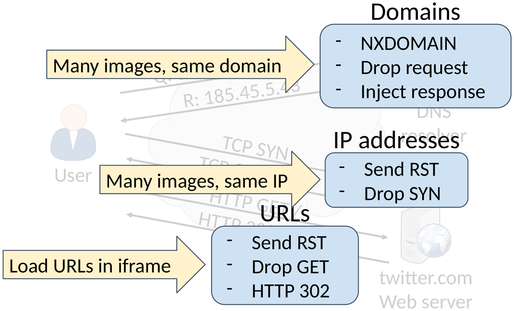
:::
::: {.column width="40%"}
- Same drawing as before, now read from the measurer's side
- **Many images, same domain** fail → the **domain** is blocked
- **Many images, same IP** fail → the **IP address** is blocked
- A **URL in an iframe** fails while others load → **URL** filtering
:::
:::

::: {.notes}
Recovered from the original pptx; the three yellow arrows used to appear one click at a
time. The point is that Encore gets only one bit per request, so it recovers the
granularity of blocking by choosing what to request: vary the domain while holding the IP
fixed, vary the IP while holding the domain fixed, and load a full page in an iframe to
test a single URL. Map each arrow back to the callout it points at on the earlier
"Where a Censor Can Intervene" slide.
:::

## Measurement Meets Real Infrastructure {.smaller}

::: {.columns}
::: {.column width="46%"}
These techniques now map **state censorship systems** at scale:

- **China's Great Firewall** — measured as a **multi-layered** system (DNS, TCP/IP,
  HTTP/S, SNI), continuously profiled by tools like **GFWeb**
- **Iran** — filtering at **multiple layers** of the stack, blocking **millions** of
  domains
- **Kazakhstan** — the state pushed its **own root CA** onto users to run a
  nationwide **HTTPS man-in-the-middle**, until browsers **blocklisted** the cert *(2019; again Dec 2020)*
:::
::: {.column width="54%"}
```{dot}
//| fig-width: 6.0
//| fig-height: 4.2
digraph g {
  rankdir=TB; nodesep=0.3; ranksep=0.55; bgcolor="transparent";
  node [shape=box, style="filled,rounded", fontname="Helvetica", fontsize=18,
        color="#555555", penwidth=1.4, margin="0.16,0.08", fillcolor="#cfe3f5"];
  edge [color="#555555", penwidth=1.5, fontname="Helvetica", fontsize=16];
  u [label="Citizen's browser\nQaznet root CA installed\non government instruction", fillcolor="#f2d9a8"];
  subgraph cluster_isp { label="Kazakh ISPs, Jul 2019 and Dec 2020"; style=dashed; color="#999999"; fontname="Helvetica"; fontsize=16;
    i [label="State interception box\nre-signs google.com, facebook.com,\nmail.ru with the Qaznet CA", fillcolor="#f8d7c4"]; }
  g [label="The real site", fillcolor="#d9efd3"];
  u -> i [label="TLS"]; i -> g [label="TLS"];
}
```
:::
:::

::: {.notes}
Book §5.2 (web-filtering subsection) names all three. The teaching point: the remote
side-channel methods scale up to characterize entire national systems. GFW is not one
box but layered filtering at DNS/TCP/HTTP/SNI. Iran (Tai et al., 2025) operates at
multiple layers and blocks millions of domains. Kazakhstan is the vivid one: in July 2019
the state told citizens to install the "Qaznet" root certificate and then MITM'd HTTPS
to ~37 domains (Google, Facebook, Mail.ru); Chrome, Firefox, and Safari blocklisted the
cert, and again when Kazakhstan retried in December 2020 (Raman et al., IMC 2020;
Mozilla, 2020). Kazakhstan is the cleanest real-world example of a *rogue root CA* —
cross-link to the Technical chapter's HTTPS/TLS material.
:::

## Other Measurement Platforms {.smaller}

- **Censored Planet** — remote, continuous, side-channel measurement at global scale
- **ICLab** — VPS-based probes across many countries
- **OONI** — volunteer probes + open data

Censored Planet packages the methods we just saw as named techniques, one per layer:

```{dot}
//| fig-width: 12.4
//| fig-height: 3.2
digraph g {
  rankdir=LR; nodesep=0.3; ranksep=0.55; bgcolor="transparent";
  node [shape=box, style="filled,rounded", fontname="Helvetica", fontsize=18,
        color="#555555", penwidth=1.4, margin="0.16,0.08", fillcolor="#cfe3f5"];
  edge [color="#555555", penwidth=1.5, fontname="Helvetica", fontsize=16];
  subgraph cluster_l { label="Layer a fetch crosses"; style=dashed; color="#999999"; fontname="Helvetica"; fontsize=16;
    dns [label="DNS lookup"]; tcp [label="TCP handshake"]; http [label="HTTP/S request"]; }
  subgraph cluster_t { label="Censored Planet technique"; style=dashed; color="#999999"; fontname="Helvetica"; fontsize=16;
    sat [label="Satellite / Iris\nopen resolvers vs. trusted answers", fillcolor="#d9efd3"];
    aug [label="Augur\nthe IP ID side channel (idle scan)", fillcolor="#d9efd3"];
    hq [label="Hyperquack\nkeyword requests to echo and discard servers", fillcolor="#d9efd3"]; }
  dns -> sat; tcp -> aug; http -> hq;
}
```

Each trades off **representativeness**, **coverage**, and **risk to people** differently.
**There is no single best vantage point.**

::: {.notes}
Book §5.1 takeaways. VPS-based (ICLab) is safe and easy but not representative of
residential users — a datacenter in a country isn't a home connection in a rural area.
Volunteer probes (OONI) are representative but raise recruitment and safety issues.
Side-channel (Censored Planet) needs no in-country consent but lives in an ethical gray
zone. The choice is a values trade-off, not a purely technical one. The named techniques
map onto exactly the methods earlier in this deck: Satellite/Iris compare open vs. trusted
resolvers (the DNS-consistency idea); Augur is the IP-ID idle/spooky scan for TCP/IP;
Hyperquack injects keywords into HTTP/S to known-behavior servers. Censored Planet has run
since Aug 2018 (95,000+ vantage points in 221 countries in the CCS 2020 paper; tens of
billions of data points by its 2022 data release). One slide, three techniques, all
already taught; callback to the ecosystem map at the start.
:::

# Measuring Platform & Legal Controls {.center}

Beyond the network: who took it down, and why? *(censorship-book §5.3–5.4)*

## Transparency Reports: Promise and Problems {.smaller}

Platforms publish **transparency reports** on takedown requests and removals. Useful — but
**self-reported and self-audited**.

::: {.columns}
::: {.column width="44%"}
**They tell you:** how many requests and removals, often by **country** and **request type**.

**They usually hide:** **who** requested it; **automated vs. manual**; appeals and
reinstatement; consistent **categories**.

X's last full report was **2017**; transparency is only as durable as a platform's will.
:::
::: {.column width="56%"}
::: {.capture}
[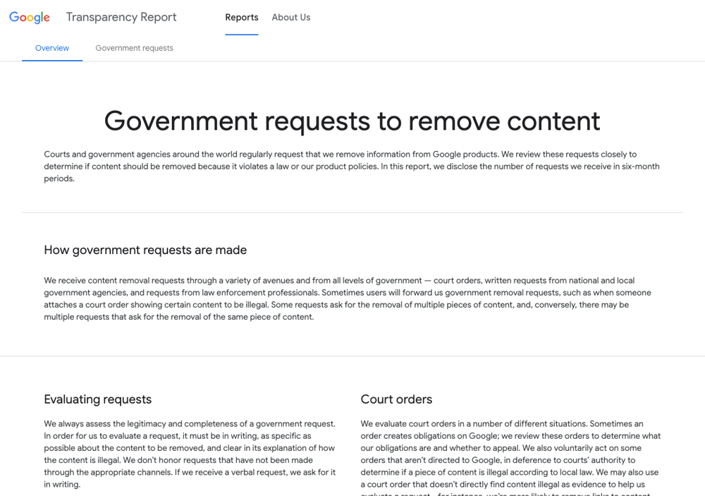{height="400px"}](https://transparencyreport.google.com/government-removals/overview)

Google Transparency Report, government requests to remove content: counts by country and reason, and nothing about who asked or whether a person decided. Captured Nov 12 2026; click to open.
:::
:::
:::

::: {.notes}
Book §5.3. The format is the message: each platform chooses what to disclose, so
cross-platform comparison is nearly impossible. Concrete examples to cite: Google's
right-to-be-forgotten reporting (~2M delisting requests, ~50% granted, all manual);
Spotify showing Russia at 22,000+ requests vs. single digits elsewhere; Reddit refusing
a Pakistani takedown and accepting the risk of being blocked. The big gap: they rarely
say *who* asked or whether a *bot* decided.
:::

## Legal & Economic Controls Need Other Tools {.smaller}

The restriction's **source** differs: platform moderation vs. **external** legal/economic
pressure.

- **[Lumen Database](https://lumendatabase.org/)** — millions of takedown notices (DMCA, court orders); reveals
  systematic **DMCA abuse** (4B+ links, false claims to bury criticism)
- **Natural experiments** — **FOSTA/SESTA** (2018), **GDPR** geo-blocking, **NetzDG**:
  compare platform behavior before/after a law
- **Economic controls** — **zero-rating**, **demonetization**, payment cutoffs, app-store
  removals — visible mostly via **self-reports**

::: {.notes}
Book §5.4. Key distinction: platform controls = platform's own decision; legal/economic
controls = external pressure on the platform. Different sources need different methods.
Lumen makes legal demands machine-readable. Laws create natural experiments — when
FOSTA/SESTA passed, Craigslist killed personals overnight; that's a measurable shock.
Economic controls (demonetization, payment cutoffs) are the hardest — platforms don't
publish them, so we rely on creator self-reports and news.
:::

## The DSA: Mandatory, Structured Transparency {.smaller}

The EU **Digital Services Act** requires **VLOPs** (45M+ EU users) to file a
**Statement of Reasons** for *every* moderation action — in **machine-readable** form.

::: {.columns}
::: {.column width="48%"}
Each SoR records: decision type · content category · **automated or human** · legal
ground · **government order?** · appeals info.

::: {.vignette}
The **DSA Transparency Database** has logged **over 9 billion** moderation decisions in
**H1 2025 alone** — but **~99%** were platforms acting on their **own terms**, not legal
orders, showing how little of online control is formal law. *(European Commission, 2025.)*
:::
:::
::: {.column width="52%"}
::: {.capture}
[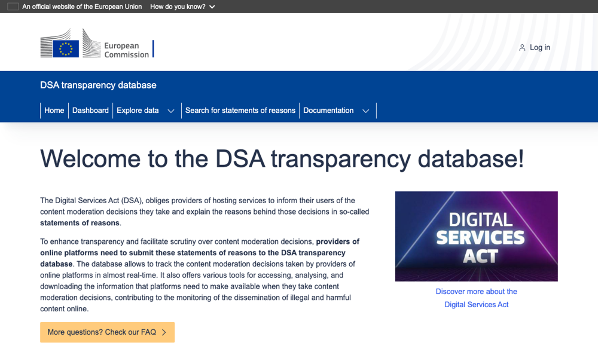{height="380px"}](https://transparency.dsa.ec.europa.eu/)

The DSA Transparency Database: every statement of reasons filed by the very large platforms, with a dashboard and bulk download. Captured Nov 12 2026; click to open.
:::
:::
:::

::: {.notes}
Book §5.3–5.4. The DSA fixes the four big gaps in voluntary reports: it's *mandatory*,
*specified*, *standardized*, and *centralized*. It even separates "orders from
authorities" from platform-initiated removals — exactly the attribution problem we
couldn't solve before. The 9-billion figure is the live hook (verify annually; the
Commission updates it). Caveats for the cold-call: it covers only VLOPs, only EU users,
and visibility ≠ accountability. The "Brussels effect" hasn't extended it globally yet.
:::

# The Ethics of Censorship Measurement {.center}

*(censorship-book §5.5)*

## Three Ways to Measure — Three Risk Profiles

```{dot}
//| fig-width: 12.4
//| fig-height: 4.0
digraph g {
  rankdir=LR; nodesep=0.3; ranksep=0.55; bgcolor="transparent";
  node [shape=box, style="filled,rounded", fontname="Helvetica", fontsize=18,
        color="#555555", penwidth=1.4, margin="0.16,0.08", fillcolor="#cfe3f5"];
  edge [color="#555555", penwidth=1.5, fontname="Helvetica", fontsize=16];
  a [label="Deploy researchers\n(Citizen Lab)", fillcolor="#f2d9a8"];
  a2 [label="consented;\nsnapshots only"];
  a3 [label="risk falls on\nthe researchers", fillcolor="#d9efd3"];
  b [label="Deploy software\nto volunteers (OONI)", fillcolor="#f2d9a8"];
  b2 [label="consented;\nbetter coverage"];
  b3 [label="risk falls on\nthe volunteers", fillcolor="#f8d7c4"];
  c [label="Co-opt deployed software\n(idle scan, Encore, open resolvers)", fillcolor="#f2d9a8"];
  c2 [label="no consent;\nscale and continuity"];
  c3 [label="risk falls on people\nwho never agreed", fillcolor="#f8d7c4"];
  a -> a2 -> a3; b -> b2 -> b3; c -> c2 -> c3;
}
```

The first two are ethically cleaner — and often **can't get the coverage** we need.

::: {.notes}
Book §5.5 overview. The cruel trade-off of the whole field: the methods that respect
consent (researchers, volunteers) can't deliver the continuous, fine-grained, baseline-
before-and-after coverage you need to study an election. The method that *can* (co-opting
devices) is the one that puts uninvolved people's machines on record reaching censored
sites. The rest of the section lives in that tension.
:::

## Censorship Measurement Falls in a Gap

```{dot}
//| fig-width: 12.4
//| fig-height: 3.4
digraph g {
  rankdir=LR; nodesep=0.3; ranksep=0.55; bgcolor="transparent";
  node [shape=box, style="filled,rounded", fontname="Helvetica", fontsize=18,
        color="#555555", penwidth=1.4, margin="0.16,0.08", fillcolor="#cfe3f5"];
  edge [color="#555555", penwidth=1.5, fontname="Helvetica", fontsize=16];
  subgraph cluster_irb { label="What an IRB reviews"; style=dashed; color="#999999"; fontname="Helvetica"; fontsize=16;
    hs [label="Human-subjects research\nstudies people", fillcolor="#d9efd3"]; }
  cm [label="Censorship measurement\nstudies a censor's behavior,\nso it falls outside", fillcolor="#f8d7c4", style="filled,rounded,dashed"];
  risk [label="Yet it can put people at real risk\nin repressive jurisdictions", fillcolor="#f8d7c4"];
  self [label="So researchers are\nlargely self-governing", fillcolor="#f2d9a8"];
  cm -> hs [label="not reviewed", style=dashed]; cm -> risk -> self;
}
```

**Legal ≠ safe**: a method legal on paper can still endanger a user; an *illegal*
measurement may create no real hazard.

::: {.notes}
Book §5.5. This is the structural problem: the oversight machinery (IRBs) was built for a
different kind of research and isn't equipped to evaluate this. So researchers are
largely self-governing. Stress the legal/safe gap — in some regimes legality is no
protection, and risk is genuinely hard to estimate in advance.
:::

## The Paradox of Consent {.smaller}

The usual safeguard — **informed consent** — can **backfire** here.

Consent at the scale and continuity needed is often **impossible**. Worse:

```{dot}
//| fig-width: 12.4
//| fig-height: 3.0
digraph g {
  rankdir=LR; nodesep=0.3; ranksep=0.55; bgcolor="transparent";
  node [shape=box, style="filled,rounded", fontname="Helvetica", fontsize=18,
        color="#555555", penwidth=1.4, margin="0.16,0.08", fillcolor="#cfe3f5"];
  edge [color="#555555", penwidth=1.5, fontname="Helvetica", fontsize=16];
  cf [label="A consent form,\nsigned", fillcolor="#f2d9a8"];
  ev [label="Documentary evidence of\nintent to test censorship", fillcolor="#f8d7c4"];
  pr [label="The user is\nmore exposed", fillcolor="#f8d7c4"];
  uw [label="An unwitting cross-origin\nrequest (how the web works)", fillcolor="#f2d9a8"];
  ind [label="Indistinguishable from\nordinary third-party traffic"];
  den [label="Plausible\ndeniability", fillcolor="#d9efd3"];
  cf -> ev -> pr; uw -> ind -> den;
}
```

The more common co-opted measurement is, the **safer** any one user becomes.

::: {.notes}
Book §5.5 "Paradox of Consent." This is the most counterintuitive and best discussion
point. The deontologist says: always get consent. The consequentialist says: consent here
may *increase* harm by documenting intent, while the noise of normal third-party traffic
protects the unwitting. Princeton's IRB on spooky scan: you can't hold a user responsible
for traffic their device sends — they might have malware; their browser already hits
hundreds of third-party domains. The web's architecture is *itself* consequentialist.
:::

## Toward Ethical Norms {.smaller}

No bright-line rules — but four guiding principles:

- **Proportionality** — risk should match benefit (a Facebook-widget probe ≠ an
  illegal-site probe in a repressive state)
- **Transparency** — tag measurements, informative PTR records, publish methods
- **Harm minimization** — choose URLs, vantage points, and data handling carefully
- **Community dialogue** — norms evolve with the technology and the politics

Salganik's *Bit by Bit* offers compatible scaffolding: **respect for persons**,
**beneficence**, **justice**, **respect for law & public interest** *(Belmont + Menlo)*.

::: {.notes}
Book §5.5 "Moving Forward." Land here: responsible measurement is governed by judgment,
not a checklist. Restricting to *infrastructure* machines (ISP resolvers, CDN nodes) is
the most common harm-mitigation move — they arguably aren't individual human subjects.
Matthew Salganik's *Bit by Bit: Social Research in the Digital Age* (2018) names four
principles for exactly this kind of consent-hard digital research: respect for persons
(autonomy/consent), beneficence (balance risk and benefit), justice (fair distribution of
risk and benefit), and respect for law and public interest. The first three come from the
1979 Belmont Report; the fourth is the 2011 Menlo Report's extension for ICT research.
They map cleanly onto the book's four: beneficence ↔ proportionality/harm-min, respect for
persons ↔ the consent debate, respect for law & public interest ↔ transparency/dialogue.
Use Salganik as the named framework students can cite. End with humility: researchers
should be modest about risks they can't foresee.
:::

## Key Takeaways {.smaller}

- Measurement is hard because control is **hidden, intermittent, hyper-localized**
- **No single right answer** (DNS) and **no single best vantage point** (probes/VPS/side
  channels) — credible studies **distinguish blocking from breakage** and **report
  conservatively**
- These methods now map **whole national systems** — China's layered GFW, Iran,
  Kazakhstan's rogue-CA HTTPS interception
- **Triangulate**: OONI + Google + transparency data corroborate each other
- **Platform/legal/economic** controls need different tools — **DSA** is a step toward
  mandatory, structured transparency
- The **ethics** are genuinely contested: consent can paradoxically **increase** risk

::: {.notes}
Recap mapping to the chapter's three takeaway boxes (§5.1, §5.2, §5.5). The throughline:
honest, bounded claims; multiple independent witnesses; and ethical humility.
:::

# Next: Taking Back Control {.center}

We can *measure* the tax. Next we study how users **route around it** —
VPNs, Tor, and circumvention.

*(see censorship-book Ch. 5 Measuring Information Controls — whole chapter; next, Ch. 6)*

::: {.notes}
Bridge to circumvention (Ch. 6). Measurement and circumvention are two sides of the same
coin: you measure to know what to circumvent, and circumvention tools (Tor, VPNs, Psiphon)
are themselves things OONI measures the blocking of. Point students at OONI Explorer and
the DSA Transparency Database for project data.
:::
