## The Cat and the Mouse {.center}

Every circumvention tool is one move in an **adversarial game**: users route around
control, censors detect and block the route, users obfuscate, censors adapt.

There is no permanent win — only a **shifting balance of cost**.

::: {.notes}
Frame the whole chapter as a cat-and-mouse game, the book's recurring metaphor. The
question is never "is this tool unbreakable?" but "does it raise the censor's cost faster
than the censor raises the user's cost?" Tie back to the course thesis: control is a *tax*
on access; circumvention is about lowering that tax for the people who need it. See
censorship-book Ch. 6 intro.
:::

## Two Cross-Cutting Themes

::: {.columns}
::: {.column width="50%"}
**Legality and risk vary**

- Running a VPN/Tor is legal speech in the US and most of Europe
- China criminalized unauthorized VPNs in **2017**; the UAE, Russia, Iran restrict tools
- The real question is rarely "is it legal?" but **"what will an adversary do if they notice?"**
:::
::: {.column width="50%"}
**Accessibility beats raw capability**

- A tool only helps if people can **install, configure, and trust** it
- Under a slow mobile link, a censored app store, and real personal risk
- **One-click** clients (Psiphon, commercial VPNs) often beat manually picking a Tor bridge
:::
:::

::: {.notes}
These two themes run through every section. The strongest tool on paper is useless if a
non-technical user under pressure can't bootstrap it. And the choice of tool is ultimately
a *threat-model* decision, not a technical one — a diaspora journalist and a domestic
activist using the same tool run very different risks. Book Ch. 6 intro.
:::

# Virtual Private Networks {.center}

*The most widely used circumvention tool — and the most misunderstood.*

## Why a Proxy at All?

The Internet is a **public network**: IP headers reveal source and destination even when
the payload is encrypted. A **passive observer can see who is talking to whom.**

A **proxy** outside the censor's firewall breaks that line of sight — you talk to the
proxy, the proxy talks to the blocked site.

<!-- recovered from ppt-archive/class/circumvention/16-Circumvention.pptx slide 4 -->
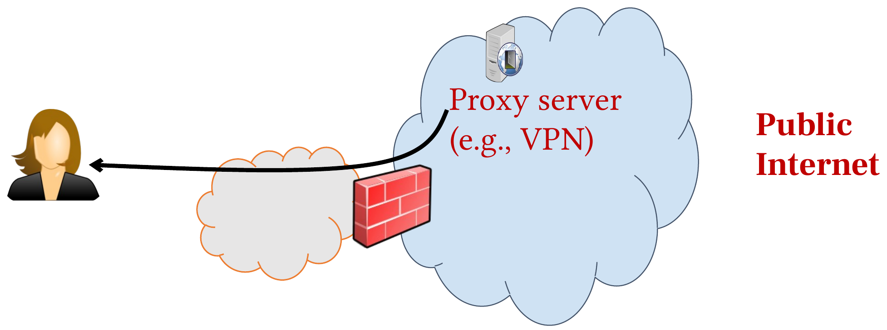{width="62%"}

::: {.notes}
Establish the core idea before naming VPNs. Encryption hides the *payload*, not the
*routing headers* — and traffic analysis can even infer content from encrypted flows. A
proxy sitting outside the firewall is the fundamental move; a VPN is just one packaging of
it. Book §6.1.
:::

## What a VPN Actually Does

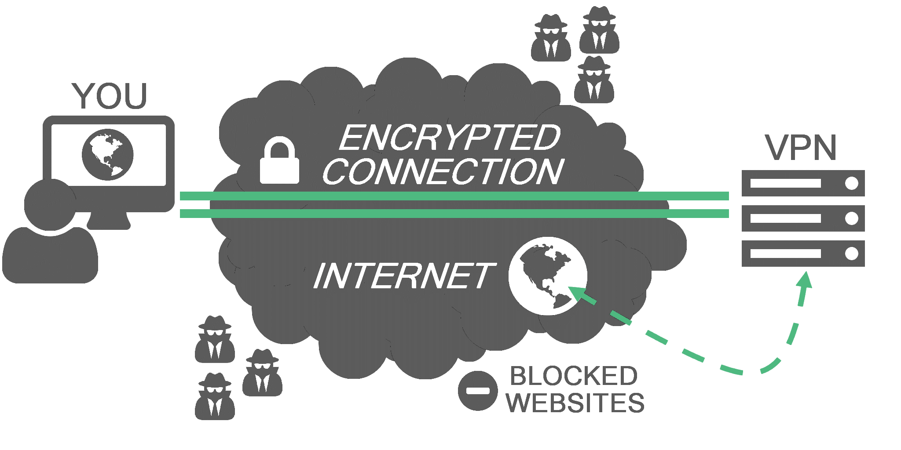{width="80%"}

**Encrypt and tunnel** your traffic to a server on the uncensored Internet; that server
fetches blocked content and relays it back.

::: {.notes}
The concept is simple. Three implicit assumptions, all of which can fail: (1) the VPN
server itself is reachable, (2) the provider is trustworthy, (3) the encrypted tunnel
can't be broken or analyzed. Enterprises use the same mechanism so employees can "be on"
the campus/corporate network from home — that's where most students first meet a VPN.
:::

## VPNs Are Not a Panacea {.smaller}

::: {.columns}
::: {.column width="50%"}
**Not always secure**

- Independent audits keep finding critical bugs in consumer VPN clients and extensions
- These can leak your **identity and traffic** — the opposite of the promise
:::
::: {.column width="50%"}
**Not always private**

- Facebook's **Onavo** marketed itself as a privacy VPN — while Facebook eavesdropped the traffic
- Rule of thumb: if the VPN is **free**, *you* may be the product
:::
:::

VPNs can also be **blocked** outright or made **illegal**.

::: {.notes}
"You get what you pay for." Free providers often monetize traffic rather than charging.
Onavo is the canonical cautionary tale — pulled from app stores, rebranded "Facebook
Research," then shut down. The protective value of a VPN depends on *who runs it* as much
as on the crypto. Book §6.1.
:::

## How People Actually Use VPNs

Survey of **729 US VPN users** (Dutkowska-Żuk et al., 2022):

- **Students** lean on VPNs to **access content** and bypass network restrictions, used *occasionally*
- **General population** uses them *continually* for **privacy and security**
- Most users have a **pragmatic, fuzzy mental model**: they know what a VPN is *for*, not what it *does*
- Both groups felt **safest with institutional** (not commercial) VPNs

::: {.notes}
Our own research (Feamster is a co-author). The headline: users choose on cost, security,
and speed; they widely *believe* free VPNs collect their data, yet use them anyway. The
gap between perceived and actual protection is the teaching point — and it generalizes to
other privacy tools. Book §6.1, dutkowska2022understanding.
:::

## Censorship Can *Increase* Access

When a platform is blocked, **VPN demand spikes** — and often stays high after the block lifts.

- Nigeria's **2021 Twitter ban**: VPN searches surged; many kept using them post-2022
- India's 2020 TikTok ban; Pakistan's **2024–25** restrictions on X (HTTPS-layer blocking)
- Once users learn a tool, many **keep it as insurance** against the next block

::: {.notes}
Roberts's paradox: censorship can *raise* information access by teaching people to
circumvent. A censorship event can permanently shift behavior. Pakistan is instructive —
strict HTTPS-layer interference, yet VPN adoption stayed elevated for months. Book §6.1.
:::

## Encrypted DNS as a Circumvention Layer

Plaintext DNS (UDP **port 53**) is the *easiest* layer to censor — a resolver just
returns the wrong answer or none. **DoH / DoT** encrypt the lookup to a third-party
resolver (**1.1.1.1**, **8.8.8.8**), so the local network can't read or rewrite it.

- **Iran, 2022** (Mahsa Amini protests): users flocked to DoH-capable apps — Signal,
  Outline, Lantern — as authorities forged DNS answers
- **Russia, post-2022 invasion**: encrypted DNS + VPNs + Tor surged together
- **But**: once a censor moves to **SNI inspection or IP blocking**, DNS encryption no
  longer hides the destination — it **buys time**, not immunity

::: {.notes}
Book §6.1 "Encrypted DNS as a circumvention layer." The teaching point is calibration:
DoH/DoT raise the cost of the *simplest* interference (DNS poisoning) and are decisive in
fast-moving events, but they are a partial measure — the destination still leaks in the TLS
SNI and the IP header. ECH/encrypted-SNI is the next move; cross-link to the Technical
chapter (DNS manipulation) and the Measurement chapter. Hounsel et al. showed DoH costs
little in page-load time, which is why browsers ship it by default.
:::

## The Cat-and-Mouse Game, Concretely

::: {.vignette}
**Russia, as of February 2026.** Roskomnadzor has confirmed blocking **469 VPN
services** and aims to block **92% of all VPNs by 2030**, backed by ~**20 billion
rubles/year** for permanent blocking infrastructure. In Jan–Apr 2025 alone it restricted
**12,600 items "promoting VPNs"** — twice all of 2024. Yet about **41% of Russian users**
still rely on a VPN. *(Sources: Roskomnadzor figures via iz.ru, Jan 22 2026; TechRadar,
2025.)*
:::

Censors block protocols (OpenVPN, WireGuard) and provider IP ranges; providers answer with
**obfuscation and rotating infrastructure**. Nobody wins permanently.

::: {.notes}
This is the freshest, best-sourced hook — swap it each year (see coverage-notes). The
lesson: "does my VPN work?" has no stable answer; it's a continuously evolving outcome of
an adversarial process. Users in China, Iran, Russia, Turkmenistan often run a *portfolio*
of 3–4 tools. Book §6.1 "Blocking the VPNs themselves."
:::

# Anonymous Communication: Tor {.center}

*From hiding **what** you say to hiding **who** is saying it.*

## Chaum's Mix: The Building Block

A **mix** (Chaum, 1981) takes in many messages, **re-encrypts and delays** them, then
forwards — so an observer can't link an incoming message to an outgoing one.

- Adversary may know **all senders and all receivers**...
- ...but **cannot link** a sent message to a received one
- Chain mixes into a **mixnet**: even one honest mix preserves anonymity

<!-- recovered from ppt-archive/class/circumvention/16-Circumvention.pptx slide 52 -->
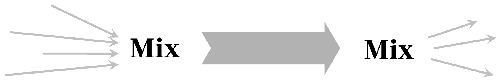{width="58%"}

::: {.notes}
The mix is the conceptual ancestor of onion routing. Its anonymity comes from *batching +
delay*, which is exactly why a basic mix is fine for email but terrible for the web.
Inserting random delays and padding foils correlation. Book §6.2.
:::

## A Mix in One Picture

::: {.columns}
::: {.column width="62%"}
<!-- recovered from ppt-archive/class/circumvention/16-Circumvention.pptx slide 51 -->
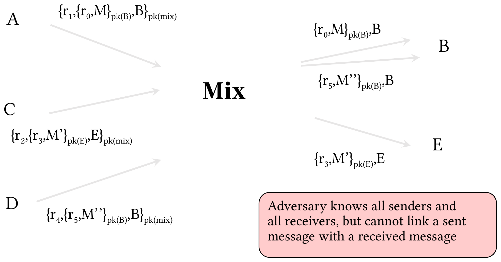
:::
::: {.column width="38%"}
- Each sender wraps the message for the **recipient**, then wraps that for the **mix**
- The mix strips its layer, **batches and reorders**, then forwards
- Random values **r** stop an observer from re-encrypting and matching
- Everyone sees who sent and who received; **nobody can pair them up**
:::
:::

::: {.notes}
Walk the picture (the original animated in one sender at a time): A, C, and D each send
{r, {r', M}_pk(B), B}_pk(mix). The mix decrypts the outer layer, discards r, waits for a
batch, shuffles, and forwards {r', M}_pk(B) to B. The adversary watching both sides sees
three messages in and three out but cannot match them, because the ciphertexts changed and
the order did. Then the cascade banner on the previous slide: chain several mixes and one
honest mix is enough. Book §6.2.
:::

## Tor: Low-Latency Onion Routing

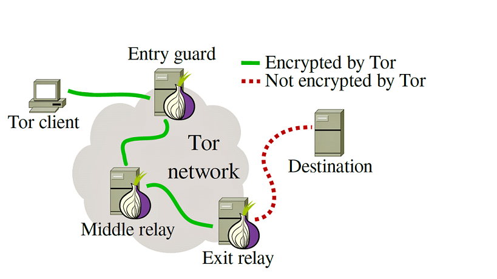{width="78%"}

Build a **circuit** with pairwise **symmetric** keys (cheap), then peel one encryption
layer per relay. No single relay sees **both** endpoints.

::: {.notes}
The design move that makes Tor usable: avoid expensive public-key ops at every hop by
setting up symmetric keys during circuit construction. Second-generation onion routing,
running ~20 years, ~2.5M users. Note the red dashed hop — exit-to-destination is *not*
Tor-encrypted, which is where exit-node and DNS-leak risks live. Book §6.2.
:::

## Choosing a Tor Circuit

<!-- recovered from ppt-archive/class/circumvention/16-Circumvention.pptx slide 63 -->
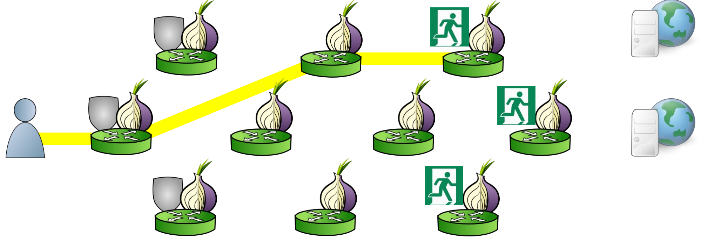{width="82%"}

- Clients start **every** circuit with their chosen **guard**; only some relays permit **exit**
- Many streams are **multiplexed** over one circuit; circuits are **rotated** periodically

::: {.notes}
Walk the picture: the client (left) always enters through its guard (shield), picks a middle
relay, and leaves through a relay whose exit policy allows the destination (exit sign). The
guard is fixed for months so that a client that keeps rebuilding circuits does not
eventually land on a malicious entry; exits are the relays that take on abuse complaints.
Book §6.2.
:::

## Tor's Threat Model and Its Limits {.smaller}

::: {.columns}
::: {.column width="50%"}
**The guarantee**

- Safe **unless** an adversary sees **both** entry and exit
- Clients start every circuit with a chosen **guard**; circuits rotate
:::
::: {.column width="50%"}
**The cracks (protocol intact, user exposed)**

- **Traffic correlation** by a global/near-global observer
- **Website fingerprinting** from packet sizes & timing
- **DNS leaks**, **rogue exit nodes**, browser fingerprinting, login mistakes
:::
:::

"Tor isn't broken" is true of the **crypto** — not of the **user**.

::: {.notes}
Key nuance the book stresses: the protocol can be sound while users are still
deanonymized. >40% of exit-relay traffic once went to Google's 8.8.8.8 — a correlation
gift. Sybil attacks (flooding the network with malicious relays) and link-level
adversaries (controlling ASes/IXPs) round out the threat model. Book §6.2 "Tracking and
Deanonymization."
:::

## Node-Level vs. Link-Level Adversaries {.smaller}

::: {.columns}
::: {.column width="50%"}
<!-- recovered from ppt-archive/class/circumvention/16-Circumvention.pptx slide 66 -->
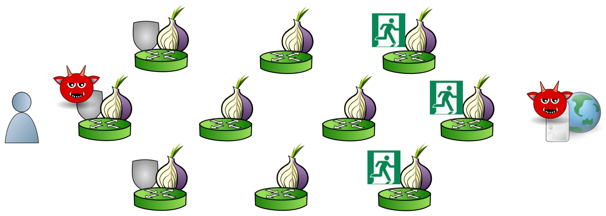

**Node-level:** run or compromise relays. Watching the **guard and the destination** at once is enough to correlate; flooding the network with relays (**Sybil**) raises the odds.
:::
::: {.column width="50%"}
<!-- recovered from ppt-archive/class/circumvention/16-Circumvention.pptx slide 67 -->
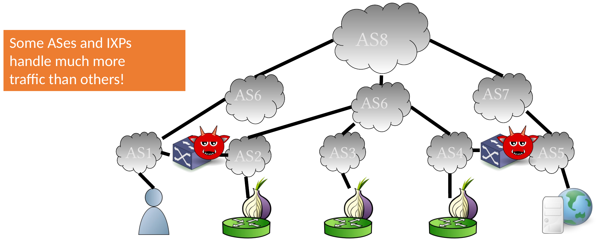

**Link-level:** sit at a fixed place in the topology, an **AS or IXP**, and see every circuit that crosses it. A few networks carry a disproportionate share of Tor traffic.
:::
:::

::: {.notes}
Two pictures the original deck built up step by step; narrate them. Left: the adversary
does not need to break any crypto, just to observe the first and last hop of the same
circuit; the Sybil variant is to run enough relays that this happens by chance. Right: an
adversary with a fixed vantage point in the AS graph (a tier-1, an IXP) can see both ends of
many circuits without running a single relay, and traffic is concentrated in a few such
places. Book §6.2 "Tracking and Deanonymization."
:::

## Onion Services and the "Dark Web"

- **.onion** services are reachable *only* through Tor — you can't stumble onto them
- **Not all illegal**: BBC, NYT, ProPublica run onion mirrors so sources/readers in
  censored countries get in safely
- But also marketplaces: **Silk Road** (Ross Ulbricht, convicted 2015)

::: {.vignette}
**January 21, 2025:** President Trump granted Ross Ulbricht a **full and unconditional
pardon** after ~11 years in prison, reigniting debate over anonymity tools and the harms
they can enable. *(Sources: NPR, CNBC, Jan 21 2025.)*
:::

::: {.notes}
Use the dark web to make the dual-use point concrete: the same anonymity that protects a
whistleblower protects a drug market. The Ulbricht pardon is a fresh, dated hook for the
policy debate — should truly anonymous tools exist given the abuse? Tor's position:
anonymity is a right worth protecting despite abuse. Book §6.2 "The Dark Web."
:::

## Beyond Tor: Pick a Portfolio {.smaller}

| System | Primary goal | Anonymity | Blocking resistance | Ease of use |
|---|---|---|---|---|
| **Tor** | Anonymous browsing | Strong | Moderate (improving w/ PTs) | Moderate |
| **I2P** | Internal hidden services | Strong (internal) | Strong (internal) | Lower |
| **Psiphon** | Access during shutdowns | Weak | Strong | High |
| **Lantern** | Access during shutdowns | Weak | Moderate | High |
| **Commercial VPN** | Privacy + access | Weak | Variable | High |

No single "best" tool — match the tool to the **threat model**.

::: {.notes}
The practical takeaway of the whole chapter. A journalist might use Tor+obfs4 for source
contact, a VPN for routine work, and Psiphon as a shutdown fallback. Psiphon bundles many
transports and auto-selects; it absorbed huge surges during Myanmar's 2021 coup and Iran's
2022–23 protests. I2P uses *garlic routing* and is best for internal services. Book §6.2
"Other Anonymous Communication Systems."
:::

## I2P: Garlic Routing for Internal Services {.smaller}

::: {.columns}
::: {.column width="50%"}
**Built for *inside* the network**

- I2P aims to connect **pseudonymous endpoints to each other**, not to fetch the clearnet
- **No exit relay** to target — internal services (file sharing, mail, IRC) are hard to block
- Reaching the clearnet needs scarce volunteer **outproxies** (slow, enumerable)
:::
::: {.column width="50%"}
**Garlic routing vs. onion routing**

- Bundle **multiple messages** into one encrypted **"garlic clove"** → harder traffic
  confirmation
- Separate **inbound and outbound tunnels** (not Tor's symmetric circuits): one compromised
  tunnel reveals only one direction
:::
:::

**Rule of thumb:** reading censored clearnet → **Tor**; running a forum/mirror that must
survive aggressive blocking → **I2P**.

::: {.notes}
Book §6.2 "Other Anonymous Communication Systems." This deepens the I2P row in the portfolio
table. Garlic routing is a variant of onion routing: cloves bundled together so an observer
can't tell which encrypted unit belongs to which conversation. The inbound/outbound tunnel
split is the other key contrast with Tor's symmetric circuits. The strengths/weaknesses
mirror Tor's almost exactly — the differentiator is the *hidden-by-default*, no-exit-relay
design, which is why I2P shines for internal services and is poor for clearnet reading.
:::

# Information Hiding {.center}

*When even the **existence** of circumvention traffic is incriminating.*

## Pluggable Transports: Disguise the Traffic

**Problem:** Deep Packet Inspection (DPI) lets a censor fingerprint and block Tor itself.

**Solution:** make Tor traffic look like *something else*.

- **Randomize** it: **obfs4**, ScrambleSuit (look like nothing)
- **Mimic** another protocol: **meek**, **WebTunnel** (look like ordinary HTTPS)
- The transports can themselves be **blocked** — so Tor ships *several*

::: {.notes}
Two families: scramble into apparent randomness, or imitate a real protocol. WebTunnel
(late 2024) blends into TLS and became vital in Russia — then most bridges were blocked by
mid-2025, forcing Tor to distribute bridge addresses over Telegram. This is the
cat-and-mouse game inside the cat-and-mouse game. Book §6.2 "Pluggable Transports."
:::

## Snowflake and Conjure: The 2025 Front Line {.smaller}

::: {.columns}
::: {.column width="50%"}
**Snowflake** — *don't be a fixed target*

- Route through **volunteer browsers** running a WebRTC proxy
- Proxies are **ephemeral**: when one dies, the client renews with another
- A single short-lived address is **not worth blocking**
:::
::: {.column width="50%"}
**Conjure** — *hide in the address space*

- Use **unused IP space inside cooperating ISPs** as decoy endpoints
- Blocking one address barely dents it; **no proxy list** to enumerate
- A refraction/decoy-style transport, now an actual deployment
:::
:::

::: {.vignette}
**Tor, 2025.** In its "most challenging year," Tor's anti-censorship team made
**Snowflake the most-used obfuscation tool in Iran** (upgraded to MV3, stress-tested on a
staging server) and **deployed Conjure** with new DNS/AMP-cache registration. Conjure's
wider rollout is slated to begin next. *(Source: Tor Project blog, "Staying Ahead of
Censors in 2025.")*
:::

::: {.notes}
This is the freshest, best-sourced pluggable-transport hook — verify yearly against the Tor
Project blog (the obfs4 → meek → WebTunnel → Snowflake/Conjure line moves). Snowflake's whole
point is that there is *no stable proxy to enumerate*: the rendezvous broker (over domain
fronting) hands the client a fresh volunteer browser, P2P over WebRTC. Conjure generalizes
decoy routing — it consumes a station inside an ISP but uses dark/unused address space so
the censor can't enumerate endpoints without breaking real traffic. Note the through-line to
the Decoy Routing section: Conjure is refraction networking that actually shipped. Not in the
book yet — flag for the next edition.
:::

## Domain Fronting

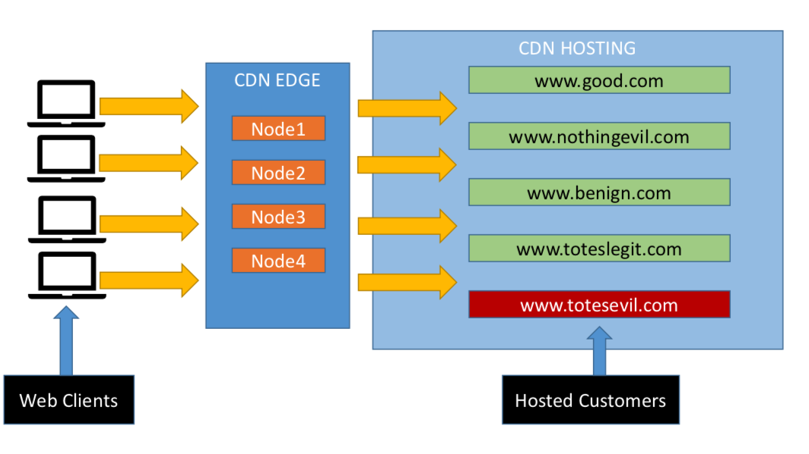{width="68%"}

A request names an **allowed** domain in the visible **SNI/IP**, but the **encrypted Host
header** names the blocked one — both on the **same CDN**.

::: {.notes}
The destination appears in three places: IP, TLS SNI (both visible), and the HTTP Host
header (encrypted). Domain fronting exploits the mismatch. Used by Tor's meek, Psiphon,
Signal, Telegram. Catch: Google and Amazon *disabled* it (checking SNI vs. Host),
"for security" — collapsing a powerful technique. Book §6.2.
:::

## Steganography: Hide the Channel Itself

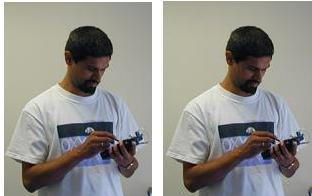{width="46%"}

Goal: hide the **existence** of communication, not just its contents. Desired properties:
**client/server deniability**, **robustness**, and usable **performance**.

::: {.notes}
Motivation: if a censor can merely *detect* you're running circumvention software, that
alone can incriminate you or justify a block — contents don't matter. Image
steganography (here, via outguess) embeds data in low-order bits. Deniability can be
deterministic or statistical; sometimes you need the censor to not even *suspect*. Book §6.3.
:::

## Covert Channels: Infranet and Collage {.smaller}

::: {.columns}
::: {.column width="50%"}
**Infranet (2001)**

- Hide requests in a **sequence of web requests**; hide responses in **images**
- Needs **dedicated** forwarders/responders — a deployment burden
:::
::: {.column width="50%"}
**Collage**

- Use **user-generated content** (Flickr, YouTube) as drop sites
- Erasure-code + steganography; **task mapping** tells Alice where to look
- **No dedicated infrastructure**; traffic looks like ordinary browsing
:::
:::

::: {.notes}
Infranet → Collage is the arc: from needing your own infrastructure to piggybacking on UGC
hosts that already serve billions of images. Collage's design goals — robust, deniable,
infrastructure-free — are the template. Task mapping hashes a message ID to "tasks" like
"search blue flowers on Flickr." Book §6.3, Burnett2010:collage.
:::

## Infranet vs. Collage in One Picture {.smaller}

::: {.columns}
::: {.column width="47%"}
<!-- recovered from ppt-archive/class/circumvention/16-Circumvention.pptx slide 90 -->
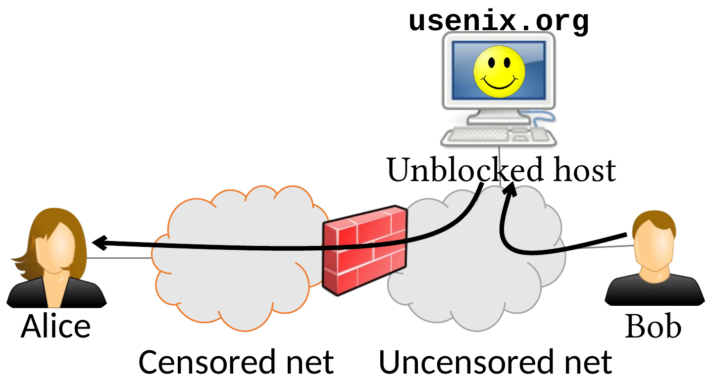

**Infranet:** Alice's requests hide in ordinary browsing of an **unblocked, cooperating** host; the host hides replies in images. Deniable, but the host is **dedicated infrastructure**.
:::
::: {.column width="53%"}
<!-- recovered from ppt-archive/class/circumvention/16-Circumvention.pptx slide 91 -->
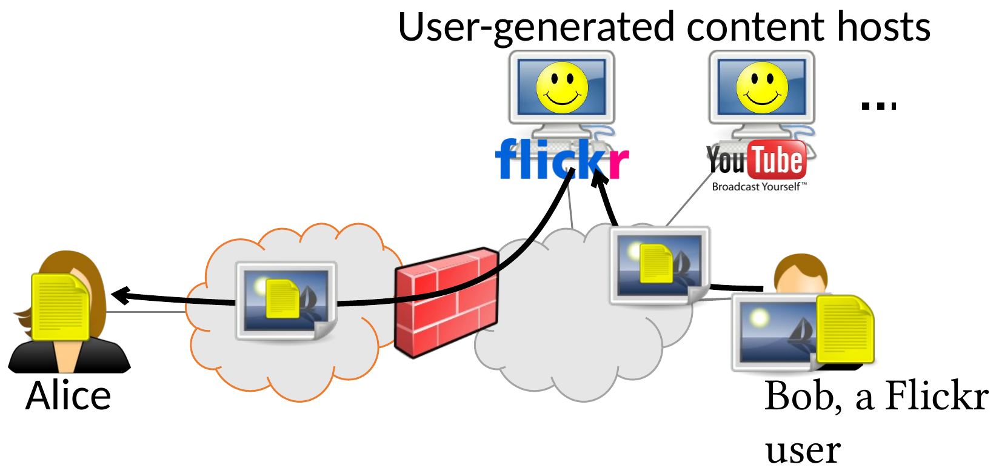

**Collage:** Bob embeds the message in photos and posts them to **Flickr or YouTube**; Alice fetches them like any other user. **No dedicated infrastructure**, and redundancy makes it robust.
:::
:::

::: {.notes}
Same cast, two designs. Infranet (2002) needs a web server that is in on the scheme, which
is exactly what a censor can enumerate and block. Collage (2010) moves the drop site to
user-generated-content hosts that already serve billions of images, so blocking the channel
means blocking Flickr. Book §6.3.
:::

## Collage: Task Mapping {.smaller}

::: {.columns}
::: {.column width="36%"}
<!-- recovered from ppt-archive/class/circumvention/16-Circumvention.pptx slide 96 -->
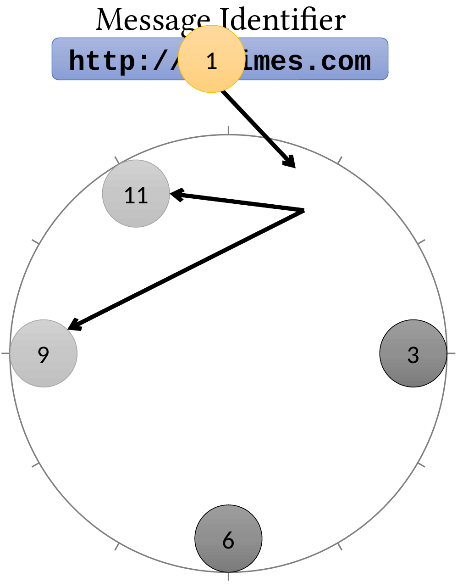
:::
::: {.column width="64%"}
How does Alice know **where to look** without anyone telling her?

- **Hash** the message identifier (a URL) and hash each **task** onto the same ring
- A task is an innocuous action: *search for blue flowers on Flickr*, *watch JohnDoe's videos*
- The identifier maps to the **closest tasks** on the ring
- The **sender** publishes vectors where those tasks land; the **receiver** performs the tasks and finds them
:::
:::

::: {.notes}
Consistent hashing applied to steganography. The picture is the final state of a build:
the identifier hashes to a point on the ring and the nearest task points are chosen. Any
task can be made deniable because it is a normal thing a user would do on the site; the
adversary would have to block the search itself. Book §6.3.
:::

## Collage in Numbers {.smaller}

::: {.columns}
::: {.column width="60%"}
<!-- recovered from ppt-archive/class/circumvention/16-Circumvention.pptx slide 100 -->
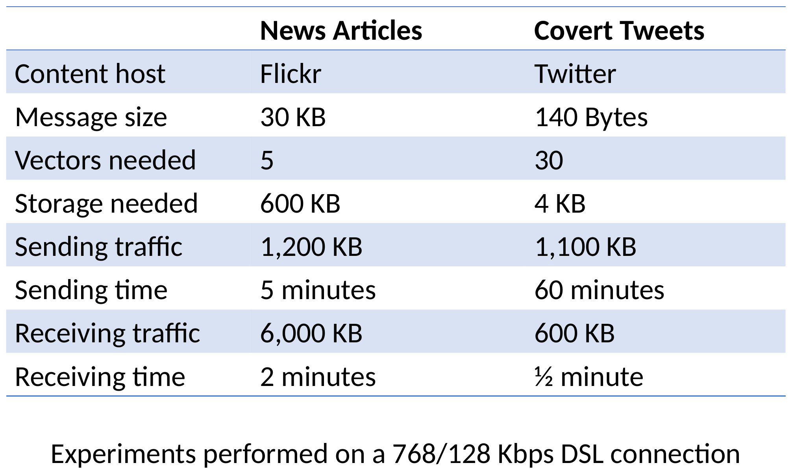
:::
::: {.column width="40%"}
- A **30 KB** article costs **1.2 MB** to send and **6 MB** to receive, to look like browsing
- A **140-byte** tweet takes **an hour** to publish across 30 vectors
- This is why information hiding is a **bootstrapping** channel, not a browsing channel
:::
:::

::: {.notes}
The numbers make the "low bandwidth" point concrete. Overheads of 40x to 200x are the price
of deniability: the cover traffic has to look like real use of the site. Read the table as
the trade-off the next slide names, the parrot problem on one side and bandwidth on the
other. Burnett, Feamster, and Vempala, "Chipping Away at Censorship Firewalls with
User-Generated Content" (USENIX Security 2010).
:::

## Why Information Hiding Stays Niche

**"The Parrot Is Dead."** Faithfully *imitating* a real protocol is **harder than
implementing it** — every quirk, bug, and corner case is a fingerprint.

- Covert channels are also **low-bandwidth**
- Today's real role: **bootstrapping** — sneak a bridge address or key past the censor,
  then switch to a faster tool
- Simpler **obfs4-on-a-real-protocol** beats elaborate mimicry in practice

::: {.notes}
The Houmansadr "Parrot is Dead" result is the key lesson: a moving target is brutally hard
to imitate. So info hiding's practical niche is narrow but real — get one small secret
past the wall to set up a high-bandwidth channel. High-bandwidth covert channels remain an
open research problem. Book §6.3.
:::

# Infrastructure Solutions {.center}

*Push circumvention **into the network** — leave no endpoint to block.*

## Decoy Routing

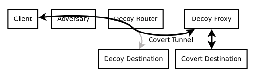{width="62%"}

A **cooperating router on the path** spots a hidden **sentinel**, then deflects your
traffic to a **covert proxy** — while the censor sees only the innocuous **decoy
destination**.

::: {.notes}
The clever inversion: there's no proxy *endpoint* for the censor to enumerate and block —
the relay is the network itself. Walk the flow: client connects normally → sends sentinel
→ decoy router resets the decoy connection and proxies to the covert destination. Curveball
(2011) put the sentinel in an HTTP field; Telex/Cirripede used the TLS handshake/TCP SYN.
Book §6.4.
:::

## Decoy Routing, Step by Step

::: {.columns}
::: {.column width="46%"}
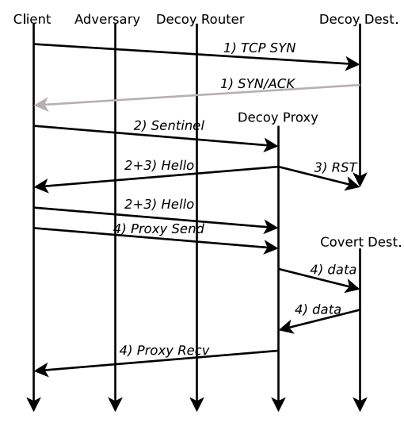
:::
::: {.column width="54%"}
1. Client opens a normal TCP/TLS connection to the **decoy destination**
2. Client sends the **sentinel**; the decoy router on the path recognizes it
3. The **decoy proxy** takes over the connection and **resets** the real decoy
4. From then on the client talks to the **covert destination** through the proxy, while the adversary still sees a flow to the decoy
:::
:::

::: {.notes}
The timeline version of the previous slide's flow. The adversary's column never changes:
every packet it sees is addressed to the decoy. The one subtle step is 3: the decoy
destination has to be quietly dropped (a RST) so it does not keep responding and confuse
the client. Book §6.4.
:::

## Decoy Routing: Promise vs. Deployment

::: {.columns}
::: {.column width="50%"}
**Why it's appealing**

- Only a **passive tap** needed, no inline blocking
- Censor **can't enumerate** the relays without breaking unrelated traffic
- Newer systems handle **asymmetric** routing & active attacks
:::
::: {.column width="50%"}
**Why it's barely deployed**

- Requires **ISP cooperation** / special on-path equipment
- The ISP's *own* customers get no benefit — bad incentives
- Mostly waiting on a **deployment story**, not more research
:::
:::

::: {.notes}
Decoy routing is technically the most elegant idea in the chapter and the least deployed.
The blocker is incentives, not cryptography: an ISP gains nothing by helping users abroad.
As software routers speed up, an on-path middlebox deployment may become feasible. Book §6.4.
:::

## Decoy Routing with Only a Passive Tap {.smaller}

::: {.columns}
::: {.column width="62%"}
<!-- recovered from ppt-archive/class/circumvention/16-Circumvention.pptx slide 110 -->
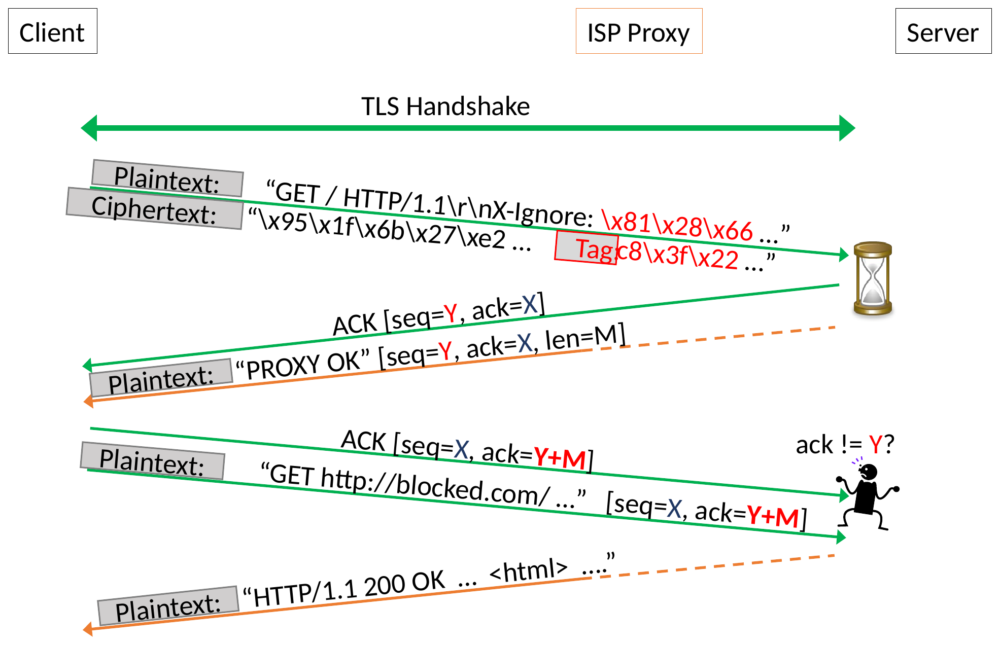
:::
::: {.column width="38%"}
- The client hides a **tag** in ciphertext the ISP tap can recognize
- The tap **spoofs the server**: it replies "PROXY OK" with the server's sequence numbers
- The real server is left **hanging**, never seeing a byte it must answer
- Later requests carry an ack the server **cannot match**, so the server ignores them; the proxy answers instead
:::
:::

::: {.notes}
This is the TapDance design (Wustrow et al., USENIX Security 2014): the ISP needs only a
mirror port, not an inline box, which is the deployment story the previous slide said was
missing. Walk the exchange top to bottom. The client's first request is padded so the
server waits for more; the proxy injects a response with the server's sequence number; the
client's acks then run ahead of what the server sent, so the server discards them. Refraction
networking's descendants (Conjure) reuse this passive-tap idea.
:::

## Who Pays for Circumvention?

The decoy-router incentive problem is one case of a **general sustainability question**:
circumvention infrastructure is mostly a **donated public good**.

- **Tor bridges, exit relays** — run by volunteers and nonprofits who absorb bandwidth,
  abuse complaints, and legal exposure
- **Snowflake** — borrows *strangers'* browsers and home bandwidth, a few seconds at a time
- **Decoy routers** — would burden ISPs whose own customers see **no benefit**
- VPNs invert it: someone pays a subscription — or **you pay with your data**

The hardest problems here are **economic, not cryptographic**.

::: {.notes}
This ties together the recurring incentive thread (decoy routing §6.4, the "free VPN = you're
the product" point §6.1, Snowflake's volunteer model). The pedagogical move: ask *who bears
the cost* of each tool. Volunteer-run infrastructure (relays, bridges, Snowflake proxies) is
chronically under-resourced and depends on grant funding (e.g., OTF) plus donated bandwidth;
exit-relay operators take on real legal/abuse risk. Decoy routing fails precisely on
incentives. The takeaway: a tool's long-run survival depends as much on a sustainable funding
and operations model as on its threat model. Cross-link to the legal/governance discussion in
Ch. 7.
:::

## The Whole Chapter in One Picture {.smaller}

| Layer | Hides... | Example | Main weakness |
|---|---|---|---|
| **VPN / proxy** | the destination | commercial/institutional VPN | server reachable & trusted? |
| **Tor** | who is talking | onion routing + guards | correlation, fingerprinting |
| **Pluggable transports** | that it's circumvention | obfs4, meek, WebTunnel | transports get blocked too |
| **Info hiding** | the channel's existence | Infranet, Collage | low bandwidth; "parrot" problem |
| **Decoy routing** | the proxy endpoint | Curveball, Telex | needs ISP cooperation |

Every layer **raises the censor's cost** — none is a final answer.

::: {.notes}
Synthesis slide. Read it as a progression *up the stack of what you're hiding*: payload →
identity → the fact of circumvention → the channel itself → the endpoint. The unifying
thesis: circumvention lowers the *tax* on access for those who need it most, while the
censor keeps raising it. Effective practice = a portfolio matched to a threat model.
:::

# Taking Back Control {.center}

Circumvention is a **continuous, adversarial process** — assemble a **portfolio**, match
it to your **threat model**, and remember that **accessibility** matters as much as
cryptographic strength.

*Read along: censorship-book Ch. 6 — Taking Back Control (whole chapter).*

::: {.notes}
Close on the chapter's two cross-cutting themes: legality/risk vary by jurisdiction, and
the most usable tool usually beats the most capable one. Point students to the full Ch. 6.
Next up in the course: the Conclusion / Internet governance (Ch. 7).
:::
